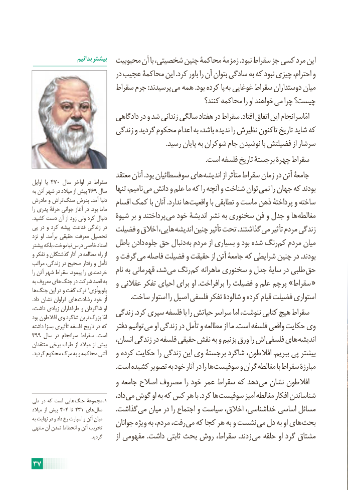

# PDF page 43

بدانیم بیشتر  محبوبیت آن با شخصیتی، چنین محاکمۀ زمزمۀ .نبود سقراط جز کسی مرد این
                            در عجیب محاکمۀ این .کرد باور را آن بتوان سادگی به که نبود چیزی احترام، و
                       سقراط جرم :پرسیدند می همه .بود کرده پا به غوغایی سقراط دوستداران میان
                                                         کنند؟ محاکمه را او خواهند می چرا چیست؟
                         دادگاهی در و شد زندانی سالگی هفتاد در سقراط .افتاد اتفاق این امّاسرانجام
                        زندگی و گردید محکوم اعدام به باشد، ندیده را نظیرش تاکنون تاریخ شاید که
                                                                              .رسید پایان به شوکران جام نوشیدن با فضیلتش از سرشار
                                                                                                      .است فلسفه تاریخ برجستۀ چهرۀ سقراط
                            معتقد آنان .بود سوفسطائیان های اندیشه از متأثر سقراط زمان در آتن جامعۀ
اوایل  یا 470 سال اواخر در سقراط
به آتن شهر در میالد از پیش 469 سال   تنها نامیم، می دانش و علم ما که را آنچه و شناخت توان نمی را جهان که بودند
مادرش و تراش سنگ پدرش .آمد دنیا   اقسام کمک با آنان .ندارد ها واقعیت با تطابقی و ماست ذهن پرداختۀ و ساخته
را پدری حرفۀ جوانی آغاز در .بود ماما
.کشید دست آن از زود ولی کرد دنبال   شیوۀ بر و پرداختند می خود اندیشۀ نشر به سخنوری فن و جدل و ها مغالطه
پی در و کرد پیشه قناعت زندگی در  فضیلت و اخالق هایی، اندیشه چنین تأثیر تحت .گذاشتند می تأثیر مردم زندگی
نزد او  .برآمد حقیقی معرفت تحصیل
بیشتر بلکه نیاموخت، درس خاصی استاد  باطل دادن جلوه حق دنبال به مردم از بسیاری و بود شده رنگ کم مردم میان
و تفکر و گذشتگان آثار در مطالعه راه از   و گرفت می فاصله فضیلت و حقیقت از آتن جامعۀ که شرایطی چنین در .بودند
مراتب زندگی، در صحیح رفتار و تأمل
را آتن شهر سقراط .پیمود را خردمندی   نام به قهرمانی شد، می رنگ کم ماهرانه سخنوری و جدل سایۀ در طلبی حق
به معروف های جنگ در شرکت                    قصد به   و عقالنی تفکر احیای برای او .برافراخت را فضیلت و علم پرچم »سقراط «                                1ها جنگ این در و گفت ترک  پِلوپونْزی
.داد نشان فراوان های رشادت خود از              .ساخت استوار را اصیل فلسفی تفکر شالودۀ و کرده قیام فضیلت استواری
داشت، زیادی طرفداران و شاگردان او  زندگی .کرد سپری فلسفه با را حیاتش سراسر اما ننوشت، کتابی هیچ سقراطبود افالطون وی شاگرد ترین بزرگ امّا
داشته بسزا تأثیری فلسفه تاریخ در که   دفتر توانیم می او زندگی در تأمل و مطالعه از ما .است فلسفه واقعی حکایت وی
399 سال در سرانجام سقراط  .است   انسان، زندگی در فلسفه حقیقی نقش به و بزنیم ورق را اش فلسفی های اندیشهمنتقدان برخی طرف از میالد از پیش
.گردید محکوم مرگ به و محاکمه آتنی   و کرده حکایت را زندگی این وی برجستۀ شاگرد افالطون، .ببریم پی بیشتر
                                                 .است کشیده تصویر به خود آثار در را ها سوفیست و گران مغالطه با سقراط مبارزۀ
                           و جامعه اصالح مصروف را خود عمر سقراط که دهد می نشان افالطون
                                   داد، می گوش او به که کس هر با .کرد ها سوفیست آمیز مغالطه افکار شناساندن طی در که است هایی  جنگ مجموعۀ .1
میالد  از پیش 404  تا 431 های سال        .گذاشت می میان در را اجتماع و سیاست اخالق، خداشناسی، اساسی مسائل
به نهایت در و داد رخ اسپارت و آتن میان    جوانان ویژه به مردم، رفت، می که کجا هر به و نشست می دل به او های بحثمنتهی آن تمدن انحطاط و آتن تخریب
                                                   .گردید      از مفهومی .داشت ثابتی بحث روش سقراط، .زدند می حلقه او گرد مشتاق

37

