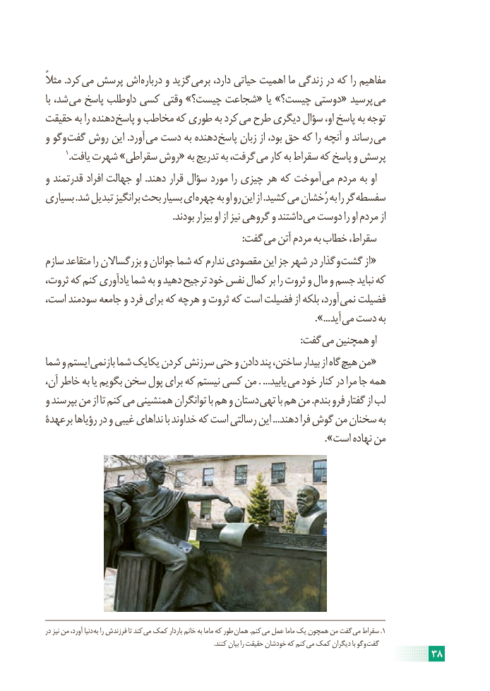

# PDF page 44

ًکردمثال .     می پرسش اش درباره و گزید برمی دارد، حیاتی اهمیت ما زندگی در که را مفاهیم
با شد، می پاسخ داوطلب کسی وقتی »چیست؟ شجاعت« یا »چیست؟ دوستی« پرسید می
حقیقت به را دهنده پاسخ و مخاطب که طوری به کرد می طرح دیگری سؤال او، پاسخ به توجه
و وگو گفت روش این .آورد می دست به دهنده پاسخ زبان از بود، حق که را آنچه و رساند می
       1.یافت شهرت »سقراطی روش« به تدریج به گرفت، می کار به سقراط که پاسخ و پرسش
و قدرتمند افراد جهالت او .دهند قرار سؤال مورد را چیزی هر که آموخت می مردم به او
بسیاری .شد تبدیل برانگیز بحث بسیار ای چهره به او رو این از .کشید می رُخشان به را گر سفسطه
  . بودند بیزار او از نیز گروهی و داشتند می دوست را او مردم از
                : گفت می آتن مردم به خطاب سقراط،
سازم متقاعد را بزرگساالن و جوانان شما که ندارم مقصودی این جز شهر در گذار و گشت از «
،کهثروت که کنم یادآوری شما به و دهید ترجیح خود نفس کمال بر را ثروت و مال و جسم نباید
است، سودمند جامعه و فرد برای که هرچه و ثروت که است فضیلت از بلکه آورد، نمی فضیلت
                                                       ...». آید می دست به
                     : گفت می همچنین او
شما و ایستم بازنمی شما یکایک کردن سرزنش حتی و دادن پند ساختن، بیدار از گاه «هیچ من
آن، خاطر به یا بگویم سخن پول برای که نیستم کسی من . ...یابید می خود کنار در مرا جا همه
و بپرسند من از تا کنم می همنشینی توانگران با هم و دستان تهی با هم من .بندم فرو گفتار از لب
برعهدۀ رؤیاها در و غیبی نداهای با خداوند که است رسالتی این ...دهند فرا گوش من سخنان به
                                                                   ».است نهاده من

در نیز من آورد، دنیا به را فرزندش تا کند می کمک باردار خانم به ماما که طور همان .کنم  می عمل ماما یک همچون من گفت  می سقراط .1
                                                                                                         .کنند بیان را حقیقت خودشان که کنم  می کمک دیگران با وگو  گفت
                                                                     38

