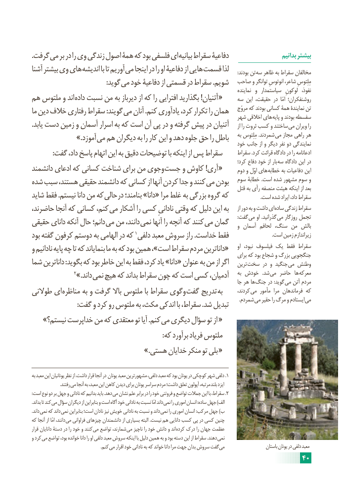

# PDF page 46

.گرفت می بر در را وی زندگی اصول همۀ که بود فلسفی ای بیانیه سقراط دفاعیۀ                      بدانیم بیشتر
آشنا بیشتر وی های اندیشه با تا آوریم می اینجا در را او دفاعیۀ از هایی قسمت لذا       :بودند تن سه ظاهر به سقراط مخالفان
         : گوید می خود دفاعیۀ از قسمتی در سقراط .شویم  صاحب و توانگر انوتوسِ شاعر، مِلِتوسِ
                                                                                                         نماینده  و  سیاستمدار  لوکونِ  نفوذ،
هم ملتوس و اند داده نسبت من به دیرباز از که را افترایی بگذارید !آتنیان «     سه این حقیقت، در  امّا روشنفکران؛
ما دین خالف رفتاری سقراط :گویند می آنان .کنم یادآوری کرد، تکرار را همان    مروّج که بودند کسانی همۀ نمایندۀ تن                                                                       شهر اخالقی های پایه و بودند سفسطه
.یابد دست زمین و آسمان اسرار به که است آن پی در و گرفته پیش در آتنیان      از را ثروت کسب و ساختند می ویران را
      .» آموزد می هم دیگران به را کار این و دهد جلوه حق را باطل    به مِلِتوس .شمردند می مجاز راهی هر                                                                               خود جانب از و دیگر نفر دو نمایندگی
            :گفت داد، پاسخ اتهام این به دقیق توضیحات با اینکه از پس سقراط      سقراط .کرد قرائت دادگاه در را ادعانامه
                                                                                              کرد؛ دفاع خود از بار سه دادگاه این در
دانشمند ادعای که کسانی شناخت برای من وجوی جست و کاوش !آری «      دوم و اوّل های خطابه به دفاعیات این
شده سبب هستند، حقیقی دانشمند که کسانی از آنها کردن جدا و کنند می بودن   سوم خطابۀ .است شده مشهور سوم و                                                                                قتل به رأی منصفه هیئت اینکه از بعد
شاید فقط .نیستم دانا من که حالی در بنامند؛ »دانا« مرا غلط به بزرگی گروه که                         .است شده ایراد داد، سقراط
حاضرند، آنجا که کسانی کنم، می آشکار را کسی نادانیِ وقتی که دلیل این به     از دور به و داشت ای ساده زندگی سقراط
حقیقی دانای آنکه حال دانم؛ می من دانند، نمی آنها را آنچه که کنند می گمان       :گفت می او .گذرانید می روزگار تجمل                                                                                         و آسمان لحافم سنگ، من بالش
بود گفته کرفون دوستم به الهامی در که 1دلفی معبد سروش راز .خداست فقط                                  .است زمین زیراندازم
و نادانیم پایه چه تا که بنمایاند ما به که بود همین ،»است سقراط مردم داناترین«     او  نبود، فیلسوف یک فقط سقراط                                                                                        برای که بود شجاع و بزرگ جنگجویی
شما داناترین :بگوید که بود خاطر این به فقط کرد، یاد »دانا« عنوان به من از اگر   ترین سخت در و جنگید می وطنش
                2».داند نمی هیچ که بداند سقراط چون که است کسی آدمیان،    به خودش   .شد می حاضر  ها معرکه                                                                                          جا هر ها جنگ در :گوید می آتن مردم
طوالنی ای مناظره به و گرفت باال ملتوس با سقراط وگوی گفت تدریج به       کردند، می مأمور  مرا فرماندهان که
                         . شمردم می حقیر را مرگ و ایستادم می                           :گفت و کرد رو ملتوس به مکث، اندکی با سقراط، .شد تبدیل
» نیستم؟ خداپرست من که معتقدی تو آیا .کنم می دیگری سؤال تو از «
                                                                              :که برآورد فریاد ملتوس
      .» «هستی خدایان منکر تو بلی

به معبد این یونانیان نظر از .داشت قرار آنجا در یونان معبد مشهورترین دلفی، معبد که بود یونان در کوچکی شهر دلفی .1
                         .رفتند می آنجا به معبد، این کاهن دیدن برای یونان سراسر مردم داشت؛ تعلق آپولون مرتبه، بلند ایزد
:است نوع دو بر جهل و نادانی که بدانیم باید .دهد می نشان علم برابر در را خود فروتنی و تواضع جمالت این با سقراط، .2
.بداند تا کند می سؤال دیگران از بنابراین و است آگاه خود نادانی به نسبت امّا داند نمی را اموری انسان :ساده جهل )الف
. داند نمی که داند نمی بنابراین است؛ نادان نیز خویش نادانی به نسبت و داند  نمی را اموری انسان :مرکب جهل )ب
که آنجا از امّا دانند، می فراوانی چیزهای دانشمندان از بسیاری البته .نیست هم دانایی کسب پی در کسی چنین
قرار دانایان دستۀ در را خود و کنند  می تواضع شمارند، می ناچیز را خود دانش و اند  کرده درک را جهان عظمت
و کرد می تواضع بود، خوانده دانا را او دلفی معبد سروش اینکه با دلیل همین به و بود دسته این از سقراط .دهند  نمی
                                                              .کنم  می اقرار خود نادانی به که خواند دانا مرا جهت بدان سروش گفت می                     باستان یونان در دلفی معبد
                                                                     40

