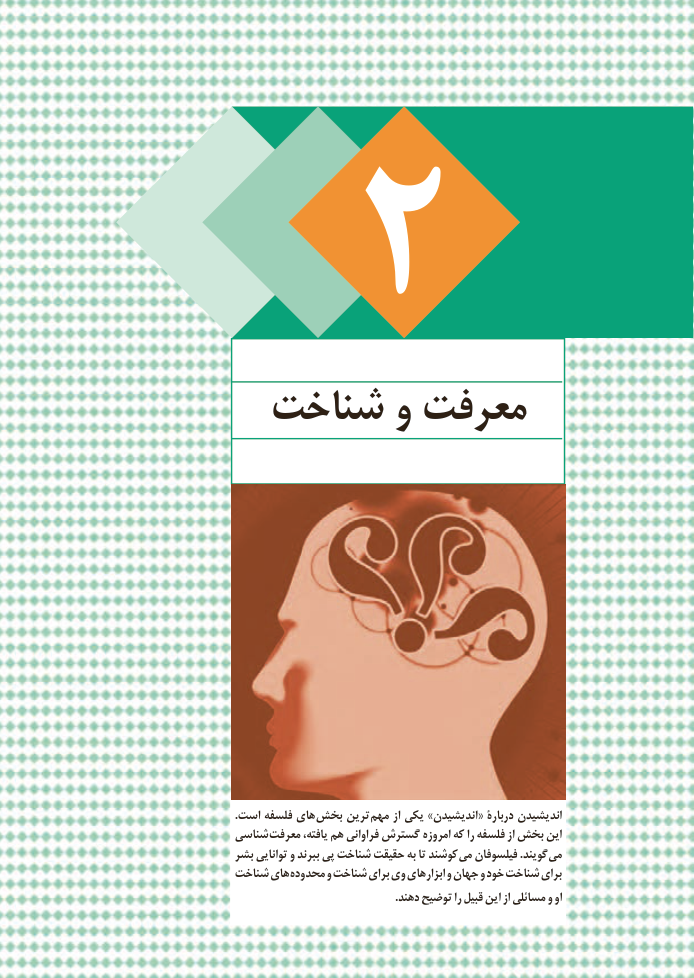

# PDF page 49

شناخت و معرفت

                                                        .است فلسفه های بخش ترین  مهم از یکی »اندیشیدن« دربارۀ اندیشیدن
                         شناسی  معرفت یافته، هم فراوانی گسترش امروزه که را فلسفه از بخش این
                           بشر توانایی و ببرند پی شناخت حقیقت به تا کوشند  می فیلسوفان .گویند  می
                         شناخت های محدوده و شناخت برای وی ابزارهای و جهان و خود شناخت برای
                                                                                                             .دهند توضیح را قبیل این از مسائلی و او
43

