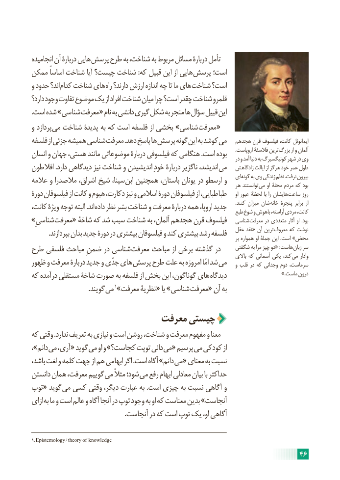

# PDF page 52

انجامیده آن دربارۀ هایی پرسش طرح به شناخت، به مربوط مسائل دربارۀ تأمل
ممکن اساساً شناخت آیا چیست؟ شناخت :که قبیل این از هایی پرسش است؛
و حدود اند؟ کدام شناخت های راه دارند؟ ارزش اندازه چه تا ما های شناخت است؟
دارد؟ وجود تفاوت موضوع یک از افراد شناخت میان چرا است؟ چقدر شناخت قلمرو
. است شده »شناسی معرفت « نام به دانشی گیری شکل به منجر ها سؤال قبیل این
و پردازد می شناخت پدیدۀ به که است فلسفه از بخشی »شناسی معرفت «
فلسفه از جزئی همیشه شناسی معرفت .دهد پاسخ ها پرسش گونه این به کوشد می   هجدهم قرن فیلسوف کانت، ایمانوئل
انسان و جهان هستی، مانند موضوعاتی دربارۀ فیلسوفی که هنگامی .است بوده       .اروپاست فالسفۀ ترین بزرگ از و آلمان                                                                                               در و آمد دنیا به کونیگسبرگ شهر در وی
افالطون .دارد دیدگاهی نیز شناخت و اندیشیدن خودِ دربارۀ ناگزیر اندیشد، می   زادگاهش ایالت از هرگز خود عمر طول
عالمه و مالصدرا اشراق، شیخ سینا، ابن همچنین باستان، یونان در ارسطو و   ای گونه به وی زندگی نظم .نرفت بیرون                                                                            هر توانستند می او محلۀ مردم که بود
دورۀ فیلسوفان از کانت و هیوم دکارت، نیز و اسالمی دورۀ فیلسوفان از طباطبایی،     او عبور لحظۀ با را هایشان ساعت روز
کانت، ویژۀ توجه البته .اند داده نظر بشر شناخت و معرفت دربارۀ همه اروپا، جدید       .کنند میزان شان خانه پنجرۀ برابر  از                                                                           طبع شوخ و باهوش آراسته، مردی کانت،
»شناسیِ معرفت« شاخۀ که شد سبب شناخت به آلمان، هجدهم قرن فیلسوف   شناسی معرفت در متعددی آثار او .بود
          .بپردازند بدان جدید دورۀ در بیشتری فیلسوفان و کند بیشتری رشد فلسفه   عقل نقد « آن ترین معروف که نوشت                                                                                                              بر همواره او جملۀ این .است »محض
طرح فلسفی مباحث ضمنِ در شناسی معرفت مباحث از برخی گذشته در     شگفتی به مرا چیز دو« :هاست زبان سر
                                                                                            باالی که آسمانی یکی کند، می وادار
ظهور و معرفت دربارۀ جدید و جدّی های پرسش طرح علت به امروزه امّا شد می    و قلب در که وجدانی دوم سرماست،
که درآمده مستقلی شاخۀ صورت به فلسفه از بخش این گوناگون، های دیدگاه                          .»ماست درون
      . گویند می 1»معرفت نظریۀ « یا »شناسی معرفت« آن به

                         معرفت چیستی
که وقتی .ندارد تعریف به نیازی و است روشن شناخت، و معرفت مفهوم و معنا
،»دانم می آری، « گوید می او و »کجاست؟ توپت دانی می« پرسیم می کودکی از
باشد، لغت و کلمه جهت از هم ابهامی اگر .است آگاه »دانم می« معنای به نسبت
دانستن همان معرفت، گوییم می مثالً شود؛ می رفع ابهام معادلی بیان با حداکثر
توپ« گوید می کسی وقتی دیگر، عبارت به .است چیزی به نسبت آگاهی و
ازای به ما و است عالم و آگاه آنجا در توپ وجود به او که معناست بدین »آنجاست
                                                        .آنجاست در که است توپ یک او، آگاهی

1. Epistemology / theory  of  knowledge
                                                                     46

