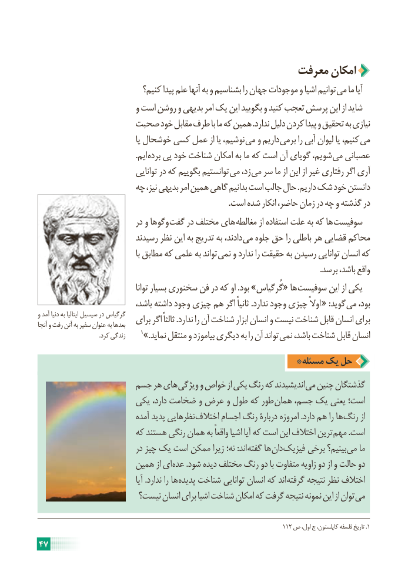

# PDF page 53

معرفت امکان
                            کنیم؟ پیدا علم آنها به و بشناسیم را جهان موجودات و اشیا توانیم می ما آیا
                           و است روشن و بدیهی امر یک این بگویید و کنید تعجب پرسش این از شاید
                صحبت خود مقابل طرف با ما که همین .ندارد دلیل کردن پیدا و تحقیق به نیازی
                                        یا خوشحال کسی عمل از یا نوشیم، می و داریم برمی را آبی لیوان یا کنیم، می
                                                 .ایم برده پی خود شناخت امکان به ما که است آن گویای شویم، می عصبانی
                                توانایی در که بگوییم توانستیم می زد، می سر ما از این از غیر رفتاری اگر آری
                     چه نیز، بدیهی امر همین گاهی بدانیم است جالب حال .داریم شک خود دانستن
                                                                                               .است شده انکار حاضر، زمان در چه و گذشته در
                            در و وگوها گفت در مختلف های مغالطه از استفاده علت به که ها سوفیست
                          رسیدند نظر این به تدریج به دادند، می جلوه حق را باطلی هر قضایی محاکم
                                             با مطابق که علمی به تواند نمی و ندارد را حقیقت به رسیدن توانایی انسان که
                                                                                                                                             .برسد باشد، واقع
                                        توانا بسیار سخنوری فن در که او .بود »گُرگیاس« ها سوفیست این از یکی
                              باشد، داشته وجود چیزی هم اگر ثانیاً .ندارد وجود چیزی اوالً « :گوید می بود،
و آمد دنیا به ایتالیا سیسیل در گرگیاس                          برای اگر ثالثاً .ندارد را آن شناخت ابزار انسان و نیست شناخت قابل انسان برایآنجا و رفت آتن به سفیر عنوان به بعدها
                                         .کرد زندگی     1».نماید منتقل و بیاموزد دیگری به را آن تواند نمی باشد، شناخت قابل انسان
                                              *مسئله  یک حل
                  جسم هر های ویژگی و خواص از یکی رنگ که اندیشیدند می چنین گذشتگان
                    یکی دارد، ضخامت و عرض و طول که طور همان جسم، یک یعنی است؛
                             آمده پدید نظرهایی اختالف اجسام رنگ دربارۀ امروزه .دارد هم را ها رنگ از
                      که هستند رنگی همان به واقعاً اشیا آیا که است این اختالف ترین مهم .است
                            در چیز یک است ممکن زیرا نه؛ :اند گفته ها دان فیزیک برخی بینیم؟ می ما
                     همین از ای عده .شود دیده مختلف رنگ دو با متفاوت زاویه دو از و حالت دو
                                         آیا .ندارد را ها پدیده شناخت توانایی انسان که اند گرفته نتیجه نظر اختالف
                       نیست؟ انسان برای اشیا شناخت امکان که گرفت نتیجه نمونه این از توان می

                                                                             112 ص اول، ج کاپلستون، فلسفه تاریخ .1
47

