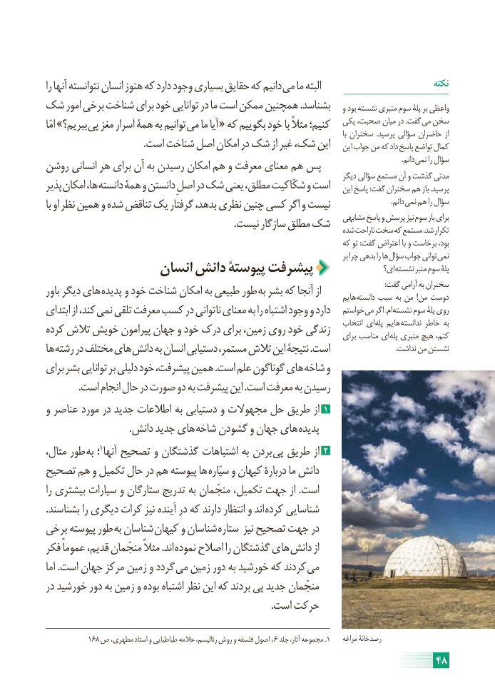

# PDF page 54

را آنها نتوانسته انسان هنوز که دارد وجود بسیاری حقایق که دانیم می ما البته                             نکته
شک امور برخی شناخت برای خود توانایی در ما است ممکن همچنین .بشناسد    و بود نشسته منبری سوم پلۀ بر واعظی
امّا »ببریم؟ پی مغز اسرار همۀ به توانیم می ما آیا « که بگوییم خود با مثالً کنیم؛   یکی صحبت، میان در .گفت می سخن                                                                                                                                                       با سخنران  .پرسید سؤالی حاضران از
                                        .است شناخت اصل امکان در شک از غیر شک، این    این جواب من که داد پاسخ تواضع کمال
                                              . دانم نمی را سؤالروشن انسانی هر برای آن به رسیدن امکان هم و معرفت معنای هم پس                                                                                      دیگر سؤالی مستمع آن و گذشت مدتی
پذیر امکان ها، دانسته همۀ و دانستن اصلِ در شک یعنی مطلق، شکّاکیت و است    این پاسخ :گفت سخنران هم باز .پرسید
با او نظر همین و شده تناقض یک گرفتار بدهد، نظری چنین کسی اگر و نیست        . دانم نمی هم را سؤال
                                                                              مشابهی پاسخ و پرسش نیز سوم بار برای                                                                             .نیست سازگار مطلق شک                                                                          شده ناراحت سخت که مستمع .شد تکرار
                                                                            که تو :گفت اعتراض با و برخاست بود،
                                                                                                              بر چرا بدهی را ها سؤال جواب توانی نمی
                                                                                          ای؟ نشسته منبر سوم پلۀ                 انسان دانش پیوستۀ پیشرفت
                                                                                                                                                                                             :گفت آرامی به سخنرانباور دیگر های پدیده و خود شناخت امکان به طبیعی طور  به بشر که آنجا از                                                                                        هایم دانسته سبب به من  !من دوست
ابتدای از کند، نمی تلقی معرفت کسب در ناتوانی معنای به را اشتباه وجود و دارد   خواستم می اگر .ام نشسته سوم پلۀ روی
                                                                                        انتخاب ای پله هایم ندانسته خاطر بهکرده تالش خویش پیرامون جهان و خود درک برای زمین، روی خود زندگی                                                                                        برای مناسب ای پله منبری هیچ کنم،
ها رشته در مختلف های دانش به انسان دستیابی مستمر، تالش این نتیجۀ .است                                    .نداشت من نشستن
برای بشر توانایی بر دلیلی خود پیشرفت، همین .است علم گوناگون های شاخه و
             .است انجام حال در صورت دو به پیشرفت این .است معرفت به رسیدن
و عناصر مورد در جدید اطالعات به دستیابی و مجهوالت حل طریق از 1
                                  .دانش جدید های  شاخه گشودن و جهان های  پدیده
مثال، طور به ؛ 1آنها تصحیح و گذشتگان اشتباهات به بردن  پی طریق از 2
تصحیح هم و تکمیل حال در هم پیوسته ها  سیّاره و کیهان دربارۀ ما دانش
را بیشتری سیارات و ستارگان تدریج به منجّمان تکمیل، جهت از .است
.بشناسند را دیگری کرات نیز آینده در که دارند انتظار و اند  کرده شناسایی
برخی پیوسته طور به شناسان  کیهان و شناسان  ستاره نیز تصحیح جهت در
فکر عموماً قدیم، منجّمان مثالً .اند نموده اصالح را گذشتگان های  دانش از
اما .است جهان مرکز زمین و گردد می زمین دور به خورشید که کردند می
در خورشید دور به زمین و بوده اشتباه نظر این که بردند پی جدید منجّمان
                                                                                             .است حرکت

            168 ص مطهری، استاد و طباطبایی عالمه رئالیسم، روش و فلسفه اصول  ، 6 جلد آثار، مجموعه .1    مراغه رصدخانۀ
                                                                     48

