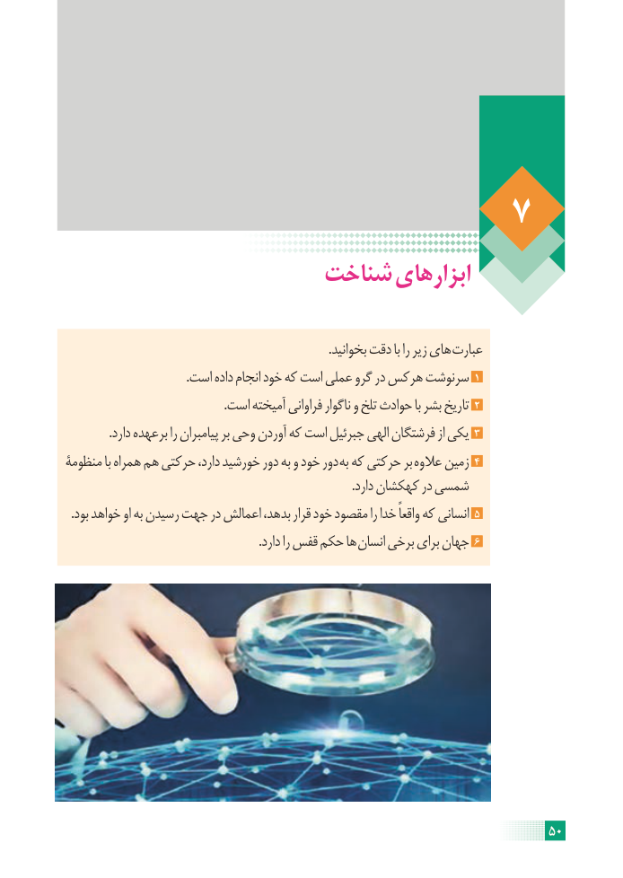

# PDF page 56

شناخت ابزارهای

                                                                                      .بخوانید دقت با را زیر های عبارت
                                        .است داده انجام خود که است عملی گرو در هرکس سرنوشت 1
                                                    .است آمیخته فراوانی ناگوار و تلخ حوادث با بشر تاریخ 2
              .دارد برعهده را پیامبران بر وحی آوردن که است جبرئیل الهی فرشتگان از یکی 3
منظومۀ با همراه هم حرکتی دارد، خورشید دور به و خود دور به که حرکتی بر عالوه زمین 4
                                                                                              .دارد کهکشان در شمسی
  .بود خواهد او به رسیدن جهت در اعمالش بدهد، قرار خود مقصود را خدا واقعاً که انسانی 5
                                                               .دارد را قفس حکم ها انسان برخی برای جهان 6

                                                                    50

