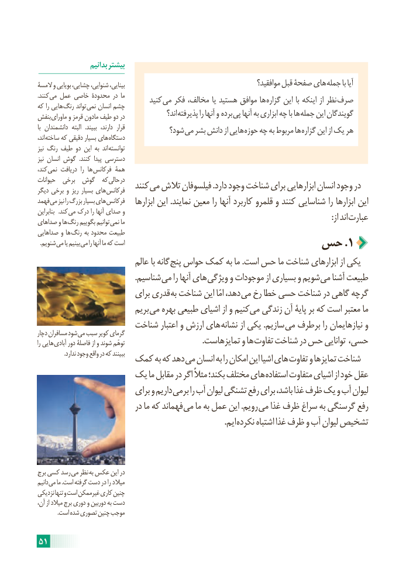

# PDF page 57

بدانیم بیشتر
المسۀ و بویایی چشایی، شنوایی، بینایی،                                             موافقید؟ قبل صفحۀ های جمله با آیا
.کنند می عمل خاصی محدودۀ در ما        کنید می فکر مخالف، یا هستید موافق ها گزاره این با اینکه از نظر صرفکه را هایی رنگ تواند نمی انسان چشم
بنفش ماورای و قرمز مادون طیف دو در                اند؟ پذیرفته را آنها و  برده پی آنها به ابزاری چه با ها جمله این گویندگان
با دانشمندان  البته   .ببیند  دارند،  قرار            شود؟ می بشر دانش از هایی حوزه چه به مربوط ها گزاره این از یک هر
اند، ساخته که دقیقی بسیار های دستگاه
نیز رنگ طیف دو این به  اند توانسته
نیز انسان گوش  .کنند  پیدا دسترسی
کند، نمی دریافت  را ها فرکانس همۀ
حیوانات  برخی  گوش  که حالی در                            کنند می تالش فیلسوفان .دارد وجود شناخت برای ابزارهایی انسان وجود دردیگر برخی و ریز بسیار های فرکانس
فهمد می نیز را بزرگ بسیار های فرکانس    ابزارها این .نمایند معین را آنها کاربرد قلمرو و کنند شناسایی را ابزارها این
بنابراین   .کند می درک را آنها صدای و                               : از اند عبارتصداهای و ها رنگ بگوییم توانیم نمی ما
صداهایی و ها رنگ به محدود طبیعت
. شنویم می یا بینیم می را آنها ما که است                          حس .1
                            عالم با گانه پنج حواس کمک به ما .است حس ما شناخت ابزارهای از یکی
                                                 .شناسیم می را آنها های ویژگی و موجودات از بسیاری و شویم می آشنا طبیعت
                          برای قدری به شناخت این امّا دهد، می رخ خطا حسی شناخت در گاهی گرچه
                            بریم می بهره طبیعی اشیای از و کنیم می زندگی آن پایۀ بر که است معتبر ما
                     شناخت اعتبار و ارزش های نشانه از یکی .سازیم می برطرف را نیازهایمان و
دچار مسافران شود می سبب کویر گرمای
را هایی آبادی دور فاصلۀ از و شوند توهّم                                       .تمایزهاست و ها تفاوت شناخت در حس توانایی حسی،
                   .ندارد وجود واقع در که ببینند                کمک به که دهد می انسان به را امکان این اشیا های تفاوت و تمایزها شناخت
                یک ما مقابل در اگر مثالً بکند؛ مختلف های استفاده متفاوت اشیای از خود عقل
                          برای و داریم برمی را آب لیوان تشنگی رفع برای باشد، غذا ظرف یک و آب لیوان
                            در ما که فهماند می ما به عمل این .رویم می غذا ظرف سراغ به گرسنگی رفع
                                                                                              .ایم نکرده اشتباه غذا ظرف و آب لیوان تشخیص

برج کسی رسد می نظر به عکس این در
دانیم می ما .است گرفته دست در را میالد
نزدیکی تنها و است غیرممکن کاری چنین
آن، از میالد برج دوری و دوربین به دست
              .است شده تصوری چنین موجب

51

