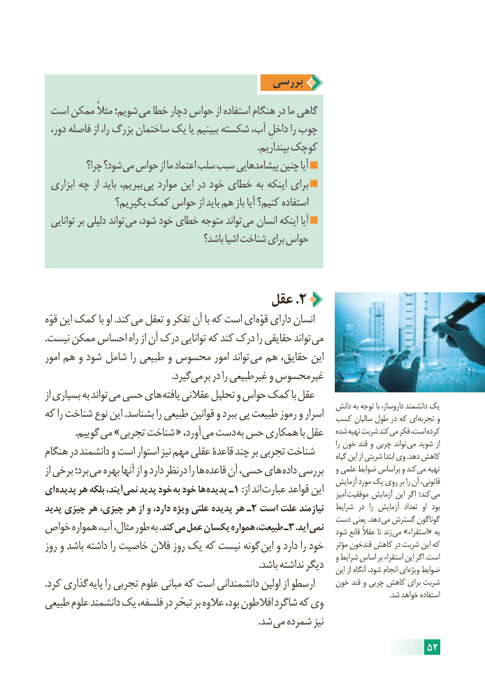

# PDF page 58

بررسی
 است ممکن مثالً شویم؛ می خطا دچار حواس از استفاده هنگام در ما گاهی
  دور، فاصله از را، بزرگ ساختمان یک یا ببینیم شکسته آب، داخلِ را چوب
                                                                                         .بپنداریم کوچک
           چرا؟ شود؟ می حواس از ما اعتماد سلب سبب پیشامدهایی چنین آیا
 ابزاری چه از باید ببریم، پی موارد این در خود خطای به اینکه برای
                بگیریم؟ کمک حواس از باید هم باز آیا کنیم؟ استفاده
  توانایی بر دلیلی تواند می شود، خود خطای متوجه تواند می انسان اینکه آیا
                                        باشد؟ اشیا شناخت برای حواس

                               عقل .2
قوّه این کمک با او .کند می تعقل و تفکر آن با که است ای قوّه دارای انسان
.نیست ممکن احساس راه از آن درک توانایی که کند درک را حقایقی تواند می
امور هم و شود  شامل را طبیعی و محسوس امور تواند می هم حقایق، این
                                                     .گیرد می بر در را غیرطبیعی و غیرمحسوس
از بسیاری به تواند می حسی های یافته عقالنی تحلیل و حواس کمک با عقل
                                                                           دانش به توجه با داروساز، دانشمند یک
که را شناخت نوع این .بشناسد را طبیعی قوانین و ببرد پی طبیعت رموز و اسرار  کسب سالیان طول در که ای تجربه و
             .گوییم می »تجربی شناخت « ،آورد می دست به حس همکاری با عقل   شده تهیه شربت کند می فکر است، کرده
                                                                                                                                        را خون قند و چربی تواند می شوید از
هنگام در دانشمند و است استوار نیز مهم عقلی قاعدۀ چند بر تجربی شناخت        گیاه این از شربتی ابتدا وی .دهد کاهش
از برخی برد؛ می بهره آنها از و دارد درنظر را ها قاعده آن حسی، های داده بررسی    و علمی ضوابط براساس و کند می تهیه
                                                                                  آزمایش مورد یک روی بر را آن قانونی،
ای پدیده هر بلکه آیند، نمی پدید خود به خود ها پدیده ـ1 :از اند عبارت قواعد این    آمیز موفقیت آزمایش این اگر کند؛ می
پدید چیزی هر چیزی، هر از و دارد، ویژه علتی پدیده هر ـ2 است علت نیازمند   شرایط  در  را آزمایش  تعداد  او  بود
                                                          دست یعنی .دهد  می گسترش گوناگون
خواص همواره آب، مثال، طور به .کند می عمل یکسان همواره طبیعت، ـ3 .آید نمی   شود قانع عقالً تا زند می »استقراء« به
روز و باشد داشته را خاصیت فالن روز یک که نیست گونه این و دارد را خود    مؤثر قندخون کاهش در شربت این که
                                                                                         و شرایط اساس بر استقراء این اگر .است
                                                                                          .باشد نداشته دیگر    این از آنگاه شود، انجام ای ویژه ضوابط
.کرد گذاری پایه را تجربی علوم مبانی که است دانشمندانی اولین از ارسطو     خون قند و چربی کاهش برای شربت
                                                                                                                                                                                                    .شد خواهد استفاده
طبیعی علوم دانشمند یک فلسفه، در تبحّر بر عالوه بود، افالطون شاگرد که وی
                                                                                          .شد می شمرده نیز
                                                                     52

