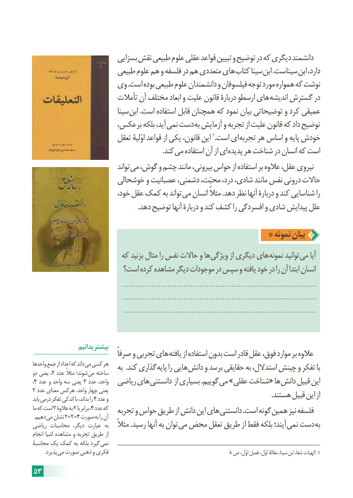

# PDF page 59

بسزایی نقش طبیعی علوم عقلی قواعد تبیین و توضیح در که دیگری دانشمند
                       طبیعی علوم هم و فلسفه در هم متعددی های کتاب سینا ابن .سیناست ابن دارد،
                  وی .است بوده طبیعی علوم دانشمندان و فیلسوفان توجه مورد همواره که نوشت
                         تأمالت آن مختلف ابعاد و علیت قانون دربارۀ ارسطو های اندیشه گسترش در
                             سینا ابن .است استفاده قابل همچنان که نمود بیان توضیحاتی و کرد عمیقی
                     برعکس، بلکه آید، نمی دست به آزمایش و تجربه از علیت قانون که داد توضیح
                         تعقل اوّلیۀ قواعد از یکی قانون، این 1.است ای تجربه هر اساس و پایه خودش
                                                                           .کند می استفاده آن از ای پدیده هر شناخت در انسان که است
                                  تواند می گوش، و چشم مانند بیرونی، حواس از استفاده بر عالوه عقل، نیروی
                      خوشحالی و عصبانیت دشمنی، محبّت، درد، شادی، مانند نفس درونی حاالت
                           خود، عقل کمک به تواند می انسان مثالً .دهد نظر آنها دربارۀ و کند شناسایی را
                                                             .دهد توضیح آنها دربارۀ و کند کشف را افسردگی و شادی پیدایش علل

                                                * نمونه بیان
                        که بزنید مثال را نفس حاالت و ها ویژگی از دیگری های نمونه توانید می آیا
                       است؟ کرده مشاهده دیگر موجودات در سپس و یافته خود در را آن ابتدا انسان
                                       .....................................................................................
                                       .....................................................................................
                                        .....................................................................................

                  بدانیم بیشتر
       ًهایصرفا و تجربی       یافته از استفاده بدون است قادر عقل فوق، موارد بر عالوه
واحدها جمع از اعداد که داند می کسی هر   به  .کند گذاری پایه را هایی دانش و برسد حقایقی به استدالل، چینش و تفکر بادو یعنی ، ٢ عدد مثالً شوند؛ می ساخته
،٤ عدد٣و واحد سه یعنی   عدد واحد،  ریاضی های دانستنی از بسیاری .گوییم می »عقلی شناخت« ها دانش قبیل این
٢ عدد معنای هرکس .واحد چهار یعنی                                                                                                                                          .هستند قبیل این ازیابد درمی٤تفکر اندکی با بداند، را  عدد و
ما که است ٢ عالوۀ به٢ با٤برابر ، عدد که   تجربه و حواس طریق از دانش این های دانستنی .است گونه همین نیز فلسفه .دهیم می٢نشان +٢=٤ صورت به را آن
ریاضی محاسبات  دیگر، عبارت  به    مثالً .رسید آنها به توان می محض تعقل طریق از فقط بلکه آیند؛ نمی دست به
انجام اشیا مشاهده و تجربه طریق از
محاسبۀ یک کمک به بلکه گیرد  نمی
  . پذیرد می صورت ذهنی و فکری                                                                         8 ص اوّل، فصل اوّل، مقالۀ سینا،  .ابن شفا، الهیات 1

53

