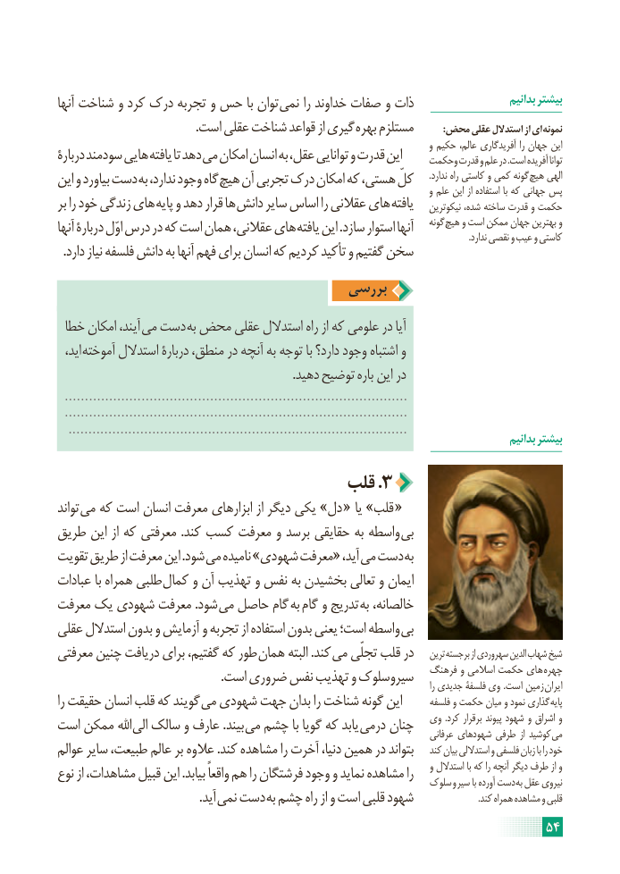

# PDF page 60

آنها شناخت و کرد درک تجربه و حس با توان نمی را خداوند صفات و ذات                      بدانیم بیشتر
                                              .است عقلی شناخت قواعد از گیری بهره مستلزم            :محض عقلی استدالل از ای نمونه
                                                                                            و حکیم عالم، آفریدگاری را جهان این
دربارۀ سودمند هایی یافته تا دهد می امکان انسان به عقل، توانایی و قدرت این     وحکمت قدرت و علم در .است آفریده توانا
این و بیاورد دست به ندارد، وجود گاه هیچ آن تجربی درک امکان که هستی، کلّ       .ندارد راه کاستی و کمی گونه هیچ الهی                                                                                            و علم این از استفاده با که جهانی پس
بر را خود زندگی های پایه و دهد قرار ها دانش سایر اساس را عقالنی های یافته    نیکوترین شده، ساخته قدرت و حکمت
آنها دربارۀ اوّل درس در که است همان عقالنی، های یافته این .سازد استوار آنها    گونه هیچ و است ممکن جهان بهترین و                                                                                                                                                                                            .ندارد نقصی و عیب و کاستی
  .دارد نیاز فلسفه دانش به آنها فهم برای انسان که کردیم تأکید و گفتیم سخن
                                     بررسی

 خطا امکان آیند، می دست به محض عقلی استدالل راه از که علومی در آیا
  اید، آموخته استدالل دربارۀ منطق، در آنچه به توجه با دارد؟ وجود اشتباه و
                                                                             .دهید توضیح باره این در
  .....................................................................................
  .....................................................................................
   .....................................................................................                                                                                                       بدانیم بیشتر

                               قلب .3
تواند می که است انسان معرفت ابزارهای از دیگر یکی »دل « یا »قلب «
طریق این از که معرفتی .کند کسب معرفت و برسد حقایقی به واسطه بی
تقویت طریق از معرفت این .شود می نامیده »شهودی معرفت« آید، می دست به
عبادات با همراه طلبی کمال و آن تهذیب و نفس به بخشیدن تعالی و ایمان
معرفت یک شهودی معرفت .شود می حاصل گام به گام و تدریج به خالصانه،
عقلی استدالل بدون و آزمایش و تجربه از استفاده بدون یعنی است؛ واسطه بی
معرفتی چنین دریافت برای گفتیم، که طور همان البته .کند می تجلّی قلب در    ترین برجسته از سهروردی الدین شهاب شیخ
                                                      .است ضروری نفس تهذیب و سیروسلوک   فرهنگ و اسالمی حکمت های  چهره                                                                                                                                               را جدیدی فلسفۀ وی .است زمین  ایران
را حقیقت انسان قلب که گویند می شهودی جهت بدان را شناخت گونه این       فلسفه و حکمت میان و نمود گذاری پایه
است ممکن اهلل الی سالک و عارف .بیند می چشم با گویا که یابد درمی چنان   وی  .کرد برقرار پیوند شهود و اشراق و                                                                                              عرفانی شهودهای طرفی  از کوشید می
عوالم سایر طبیعت، عالم بر عالوه .کند مشاهده را آخرت دنیا، همین در بتواند    کند بیان استداللی و فلسفی زبان با را خود
نوع از مشاهدات، قبیل این .بیابد واقعاً هم را فرشتگان وجود و نماید مشاهده را    و استدالل با که را آنچه دیگر طرف از و                                                                    سلوک و سیر با آورده دست به عقل نیروی
             . آید نمی دست به چشم راه از و است قلبی شهود                              .کند همراه مشاهده و قلبی
                                                                     54

