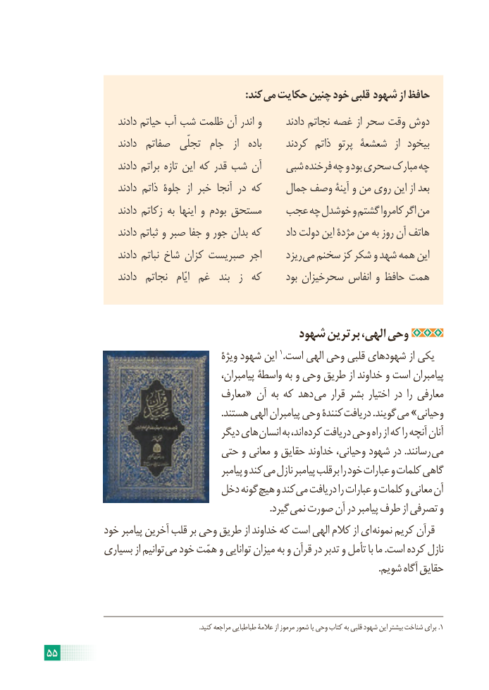

# PDF page 61

:کند می حکایت چنین خود قلبی شهود از حافظ
                   دادند حیاتم آب شب ظلمت آن اندر و      دادند نجاتم غصه از سحر وقت دوش
                   دادند  صفاتم  تجلّی  جام   از   باده     کردند  ذاتم  پرتو شعشعۀ  از  بیخود
                   دادند براتم تازه این که قدر شب آن    شبی فرخنده چه و بود سحری مبارک چه
                   دادند ذاتم جلوۀ  از خبر آنجا در که    جمال وصف آینۀ و من روی این از بعد
                   دادند زکاتم به اینها و بودم مستحق   عجب چه خوشدل و گشتم کامروا اگر من
                   دادند ثباتم و صبر جفا و جور بدان که       داد دولت این مژدۀ من به روز آن هاتف
                   دادند نباتم شاخ کزان صبریست اجر      ریزد می سخنم کز شکر و شهد همه این
                   دادند  نجاتم   ایّام غم  بند  ز  که      بود سحرخیزان انفاس و حافظ همت

                                      شهود برترین الهی، وحی
                                           ویژۀ شهود این 1.است الهی وحی قلبی شهودهای از یکی
                                               پیامبران، واسطۀ به و وحی طریق از خداوند و است پیامبران
                                    معارف « آن به که دهد می قرار بشر اختیار در را معارفی
                                                                         .هستند الهی پیامبران وحی کنندۀ دریافت .گویند می »وحیانی
                                      دیگر های انسان به اند، کرده دریافت وحی راه از که را آنچه آنان
                              حتی و معانی و حقایق خداوند وحیانی، شهود در .رسانند می
                                                 پیامبر و کند می نازل پیامبر برقلب را خود عبارات و کلمات گاهی
                             دخل گونه هیچ و کند می دریافت را عبارات و کلمات و معانی آن
                                                                                             .گیرد نمی صورت آن در پیامبر طرف از تصرفی و
           خود پیامبر آخرین قلب بر وحی طریق از خداوند که است الهی کالم از ای نمونه کریم قرآن
            بسیاری از توانیم می خود همّت و توانایی میزان به و قرآن در تدبر و تأمل با ما .است کرده نازل
                                                                                                                                          .شویم آگاه حقایق

  . .1کنید مراجعه طباطبایی عالمۀ از مرموز شعور یا وحی کتاب به قلبی شهود این بیشتر شناخت برای

55

