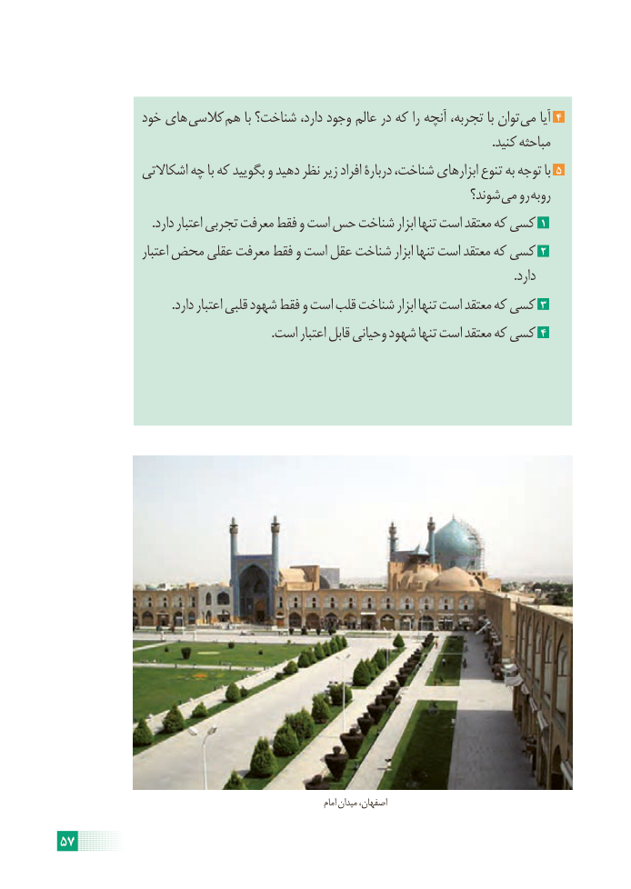

# PDF page 63

خود های کالسی هم با شناخت؟ دارد، وجود عالم در که را آنچه تجربه، با توان می آیا 4
                                                                                                                                           .کنید مباحثه
              اشکاالتی چه با که بگویید و دهید نظر زیر افراد دربارۀ شناخت، ابزارهای تنوع به توجه با 5
                                                                    شوند؟ می رو روبه
                              .دارد اعتبار تجربی معرفت فقط و است حس شناخت ابزار تنها است معتقد که کسی 1
                  اعتبار محض عقلی معرفت فقط و است عقل شناخت ابزار تنها است معتقد که کسی 2
                                                                                                                                                   .دارد
                                    .دارد اعتبار قلبی شهود فقط و است قلب شناخت ابزار تنها است معتقد که کسی 3
                                                                    .است اعتبار قابل وحیانی شهود تنها است معتقد که کسی 4

                                                                                     امام میدان اصفهان،

57

