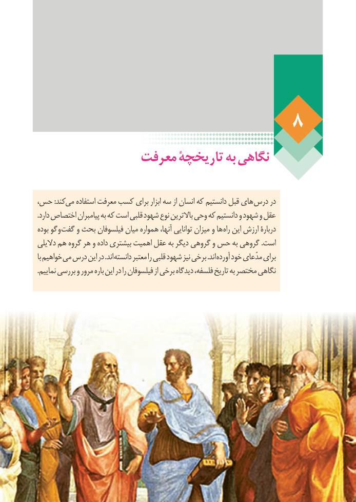

# PDF page 64

معرفت تاریخچۀ به نگاهی

،کندحس :     می استفاده معرفت کسب برای ابزار سه از انسان که دانستیم قبل های درس در
.دارد اختصاص پیامبران به که است قلبی شهود نوع باالترین وحی که دانستیم و شهود و عقل
بوده گو و گفت و بحث فیلسوفان میان همواره آنها، توانایی میزان و ها راه این ارزش دربارۀ
دالیلی هم گروه هر و داده بیشتری اهمیت عقل به دیگر گروهی و حس به گروهی .است
با خواهیم می درس این در .اند دانسته معتبر را قلبی شهود نیز برخی .اند آورده خود مدّعای برای
.نماییم بررسی و مرور باره این در را فیلسوفان از برخی دیدگاه فلسفه، تاریخ به مختصر نگاهی

                                                                    58

