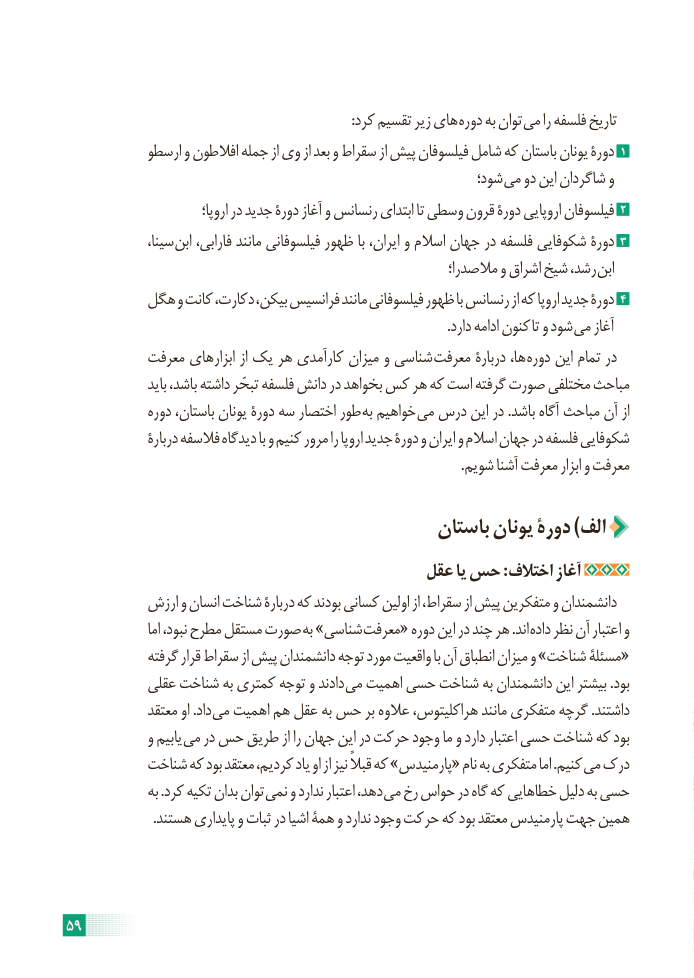

# PDF page 65

:کرد تقسیم زیر های دوره به توان می را فلسفه تاریخ
            ارسطو و افالطون جمله از وی از بعد و سقراط از پیش فیلسوفان شامل که باستان یونان دورۀ 1
                                                               شود؛ می دو این شاگردان و
                               اروپا؛ در جدید دورۀ آغاز و رنسانس ابتدای تا وسطی قرون دورۀ اروپایی فیلسوفان 2
               ،سینا ابن فارابی، مانند فیلسوفانی ظهور با ایران، و اسالم جهان در فلسفه شکوفایی دورۀ 3
                                                              مالصدرا؛ و اشراق شیخ رشد، ابن
         هگل و کانت دکارت، بیکن، فرانسیس مانند فیلسوفانی ظهور با رنسانس از که اروپا جدید دورۀ 4
                                                                                                                .دارد ادامه کنون تا و شود می آغاز
           معرفت ابزارهای از یک هر کارآمدی میزان و شناسی معرفت دربارۀ ها، دوره این تمام در
                 باید باشد، داشته تبحّر فلسفه دانش در بخواهد کس هر که است گرفته صورت مختلفی مباحث
              دوره باستان، یونان دورۀ سه اختصار طور به خواهیم می درس این در .باشد آگاه مباحث آن از
                دربارۀ فالسفه دیدگاه با و کنیم مرور را اروپا جدید دورۀ و ایران و اسالم جهان در فلسفه شکوفایی
                                                                                                                    .شویم آشنا معرفت ابزار و معرفت

                                           باستان یونان دورۀ )الف
                                        عقل یا حس : اختالف آغاز
           ارزش و انسان شناخت دربارۀ که بودند کسانی اولین از سقراط، از پیش متفکرین و دانشمندان
                   اما نبود، مطرح مستقل صورت به »شناسی معرفت« دوره این در چند هر .اند داده نظر آن اعتبار و
             گرفته قرار سقراط از پیش دانشمندان توجه مورد واقعیت با آن انطباق میزان و »شناخت مسئلۀ«
           عقلی شناخت به کمتری توجه و دادند می اهمیت حسی شناخت به دانشمندان این بیشتر .بود
             معتقد او .داد می اهمیت هم عقل به حس بر عالوه هراکلیتوس، مانند متفکری گرچه .داشتند
             و یابیم می در حس طریق از را جهان این در حرکت وجود ما و دارد اعتبار حسی شناخت که بود
          شناخت که بود معتقد کردیم، یاد او از نیز قبالً که »پارمنیدس« نام به متفکری اما .کنیم می درک
               به .کرد تکیه بدان توان نمی و ندارد اعتبار دهد، می رخ حواس در گاه که خطاهایی دلیل به حسی
                         .هستند پایداری و ثبات در اشیا همۀ و ندارد وجود حرکت که بود معتقد پارمنیدس جهت همین

59

