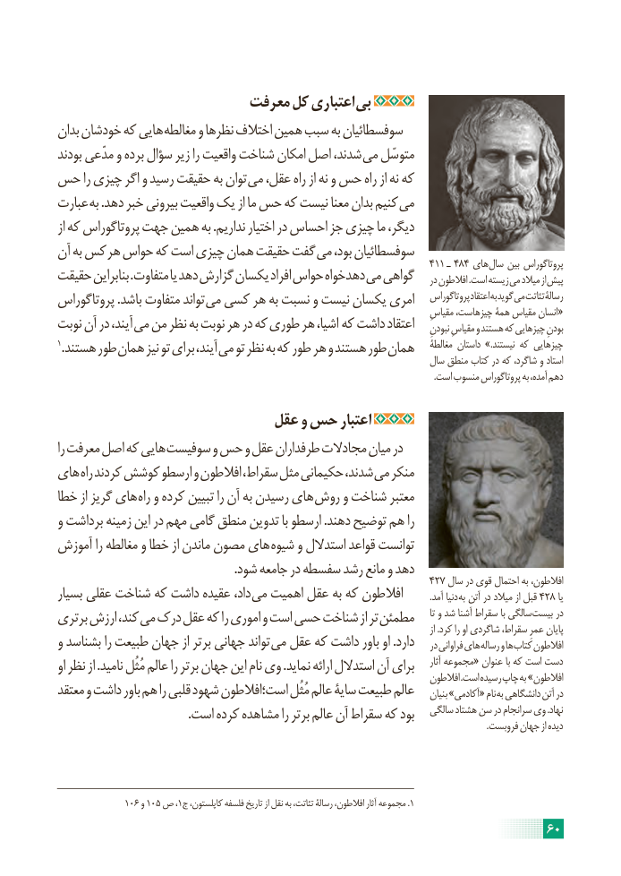

# PDF page 66

معرفت کل اعتباری بی
بدان خودشان که هایی مغالطه و نظرها اختالف همین سبب به سوفسطائیان
بودند مدّعی و برده سؤال زیر را واقعیت شناخت امکان اصل شدند، می متوسّل
حس را چیزی اگر و رسید حقیقت به توان می عقل، راه از نه و حس راه از نه که
عبارت به .دهد خبر بیرونی واقعیت یک از ما حس که نیست معنا بدان کنیم می
از که پروتاگوراس جهت همین به .نداریم اختیار در احساس جز چیزی ما دیگر،
آن به کس هر حواس که است چیزی همان حقیقت گفت می بود، سوفسطائیان
                                                                                               411  ـ  484 های سال بین پروتاگوراس
حقیقت بنابراین .متفاوت یا دهد گزارش یکسان افراد حواس دهدخواه می گواهی    در افالطون .است زیسته می میالد از پیش
پروتاگوراس .باشد متفاوت تواند می کسی هر به نسبت و نیست یکسان امری    پروتاگوراس اعتقاد به گوید می تئاتت رسالۀ
                                                                                              مقیاسِ چیزهاست، همۀ مقیاس انسان «
نوبت آن در آیند، می من نظر به نوبت هر در که طوری هر اشیا، که داشت اعتقاد ِبودنِنبودن مقیاسِ و هستند که چیزهایی
1.هستند طور همان نیز تو برای آیند، می تو نظر به که طور هر و هستند طور همان    مغالطۀ داستان .»نیستند که چیزهایی
                                                                           سال منطق کتاب در که شاگرد، و استاد
                                                                                                                                                                              .است منسوب پروتاگوراس به آمده، دهم

                           عقل و حس اعتبار
را معرفت اصل که هایی سوفیست و حس و عقل طرفداران مجادالت میان در
های راه کردند کوشش ارسطو و افالطون سقراط، مثل حکیمانی شدند، می منکر
خطا از گریز های راه و کرده تبیین را آن به رسیدن های روش و شناخت معتبر
و برداشت زمینه این در مهم گامی منطق تدوین با ارسطو .دهند توضیح هم را
آموزش را مغالطه و خطا از ماندن مصون های شیوه و استدالل قواعد توانست
                                                          .شود جامعه در سفسطه رشد مانع و دهد
                                                                       427 سال در قوی احتمال به افالطون،
بسیار عقلی شناخت که داشت عقیده داد، می اهمیت عقل به که افالطون            .آمد دنیا به آتن در میالد از قبل 428 یا
برتری ارزش کند، می درک عقل که را اموری و است حسی شناخت از تر مطمئن      تا و شد آشنا سقراط با سالگی بیست در
                                                                                                                                         از .کرد را او شاگردی سقراط، عمرِ پایان
و بشناسد را طبیعت جهان از برتر جهانی تواند می عقل که داشت باور او .دارد    در فراوانی های رساله و ها کتاب افالطون
او نظر از .نامید مُثُل عالم را برتر جهان این نام وی .نماید ارائه استدالل آن برای     آثار مجموعه« عنوان با که است دست
                                                                                      افالطون .است رسیده چاپ به »افالطون
معتقد و داشت باور هم را قلبی شهود است؛افالطون مُثُل عالم سایۀ طبیعت عالم    بنیان »آکادمی« نام به دانشگاهی آتن در
                                           .است کرده مشاهده را برتر عالم آن سقراط که بود   سالگی هشتاد سن در سرانجام وی .نهاد
                                                                                                                                                                                                .فروبست جهان از دیده

              106 و 105 ص ،1.ج کاپلستون، فلسفه تاریخ از نقل به تئاتت، رسالۀ افالطون، آثار مجموعه 1
                                                                     60

