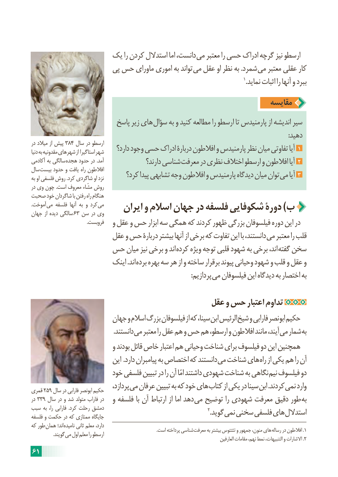

# PDF page 67

یک را کردن استدالل اما دانست، می معتبر را حسی ادراک گرچه نیز ارسطو
                      پی حس ماورای اموری به تواند می عقل او نظر به .شمرد می معتبر عقلی کار
                                                                                                             1.نماید اثبات را آنها و ببرد
                                                                 مقایسه
                         پاسخ زیر های سؤال به و کنید مطالعه را ارسطو تا پارمنیدس از اندیشه سیر
                                                                                                                                                           :دهید
در میالد از پیش 384 سال در ارسطو
دنیا به مقدونیه شهرهای از استاگیرا شهر     دارد؟ وجود حسی ادراک دربارۀ افالطون و پارمنیدس نظر میان تفاوتی آیا 1
آکادمی به سالگی هجده حدود در .آمد                 دارند؟ شناسی معرفت در نظری اختالف ارسطو و افالطون آیا 2
سال بیست حدود و یافت راه افالطون
به او فلسفی روش .کرد شاگردی او نزد       کرد؟ پیدا تشابهی وجه افالطون و پارمنیدس دیدگاه میان توان می آیا 3
در وی چون .است معروف مشّاء روش
صحبت خود شاگردان با رفتن راه هنگام
.آموخت می فلسفه آنها به و کرد می     ایران و اسالم جهان در فلسفه شکوفایی دورۀ )ب  جهان از دیده سالگی 63 سن در وی
                                             .فروبست   و عقل و حس ابزار سه همگی که کردند ظهور بزرگی فیلسوفان دوره این در
                    عقل و حس دربارۀ بیشتر آنها از برخی که تفاوت این با دانستند، می معتبر را قلب
             حس میان نیز برخی و اند کرده ویژه توجه قلبی شهود به برخی اند، گفته سخن
                       اینک .اند برده بهره سه هر از و ساخته برقرار پیوند وحیانی شهود و قلب و عقل و
              : پردازیم می فیلسوفان این دیدگاه به اختصار به

                                         عقل و حس اعتبار تداوم
                      جهان و اسالم بزرگ فیلسوفان از که سینا، ابن الرئیس شیخ و فارابی ابونصر حکیم
       . دانستند می معتبر را عقل هم و حس هم ارسطو، و افالطون مانند آیند، می شمار به
                           و بودند قائل خاص اعتبار هم وحیانی شناخت برای فیلسوف دو این همچنین
                           این .دارد پیامبران به اختصاص که دانستند می شناخت های راه از یکی هم را آن
                       خود فلسفی تبیین در را آن امّا داشتند شهودی شناخت به نگاهی نیم فیلسوف دو
                                  پردازد، می عرفان تبیین به که خود های کتاب از یکی در سینا ابن .کردند نمی واردقمری 259 سال در فارابی ابونصر حکیم
در 339 سال در و شد متولد فاراب در   و فلسفه با آن ارتباط از اما دهد می توضیح را شهودی معرفت دقیق طور به
سبب به  را، فارابی  .کرد رحلت دمشق                                                                                             2.گوید نمی سخنی فلسفی های استداللفلسفه و حکمت در که ممتازی جایگاه
که طور همان اند؛ نامیده ثانی معلم دارد،                                                                                                                 .است پرداخته شناسی معرفت به بیشتر تئتتوس و جمهور منون، های .رساله در افالطون 1   . گویند می اول معلم را ارسطو                                                                                                              العارفین مقامات نهم، نمط التنبیهات، و االشارات .2
61

