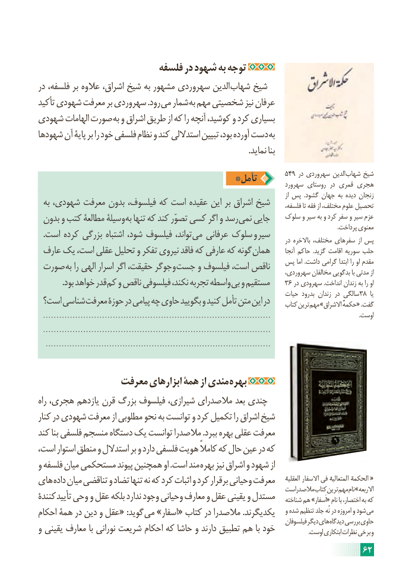

# PDF page 68

فلسفه در شهود به توجه
در فلسفه، بر عالوه اشراق، شیخ به مشهور سهروردی الدین شهاب شیخ
تأکید شهودی معرفت بر سهروردی .رود می شمار به مهم شخصیتی نیز عرفان
شهودی الهامات صورت به و اشراق طریق از که را آنچه کوشید، و کرد بسیاری
شهودها آن پایۀ بر را خود فلسفی نظام و کند استداللی تبیین بود، آورده دست به
                                                                                                        .نماید بنا
                                                                      549 در سهروردی الدین شهاب شیخ                                   *تأمل                                                                                سهرورد روستای در قمری هجری
                                                                                                                                      از پس  .گشود جهان به دیده زنجان  به شهودی، معرفت بدون فیلسوف، که است عقیده این بر اشراق شیخ      فلسفه، تا فقه از مختلف، علوم تحصیل
 بدون و کتب مطالعۀ وسیلۀ به تنها که کند تصوّر کسی اگر و رسد نمی جایی    سلوک و سیر به و کرد سفر و سیر عزم                                                                                                                                                                                                        .پرداخت معنوی  .است کرده بزرگی اشتباه شود، فیلسوف تواند، می عرفانی سلوک و سیر                                                                                              در باالخره مختلف، سفرهای از پس
 عارف یک است، عقلی تحلیل و تفکر نیروی فاقد که عارفی که گونه همان      آنجا حاکم  .گزید اقامت سوریه حلب
 صورت به را الهی اسرار اگر حقیقت، جوگر و جست و فیلسوف است، ناقص   پس اما .داشت گرامی ابتدا را او مقدم                                                                              سهروردی، مخالفان بدگویی با مدتی از
 . بود خواهد قدر کم و ناقص فیلسوفی نکند، تجربه واسطه بی و مستقیم    36 در سهرودی .انداخت زندان به را او
                                                                           حیات بدرود زندان در سالگی 38  یا است؟ شناسی معرفت حوزۀ در پیامی چه حاوی بگویید و کنید تأمل متن این در     کتاب ترین مهم »االشراق حکمهًْگفت« .
  .....................................................................................                                                            .اوست
  .....................................................................................
   .....................................................................................

               معرفت ابزارهای همۀ از مندی بهره
راه هجری، یازدهم قرن بزرگ فیلسوف شیرازی، مالصدرای بعد چندی
کنار در شهودی معرفت از مطلوبی نحو به توانست و کرد تکمیل را اشراق شیخ
کند بنا فلسفی منسجم دستگاه یک توانست مالصدرا .ببرد بهره عقلی معرفت
است، استوار منطق و استدالل بر و دارد فلسفی هویت کامالً که حال عین در که
و فلسفه میان مستحکمی پیوند همچنین او .است مند بهره نیز اشراق و شهود از
های داده میان تناقضی و تضاد تنها نه که کرد اثبات و کرد برقرار وحیانی معرفت     العقلیه   االسفار  فی   المتعالیه   الحکمه   «                                                                            مالصدراست کتاب ترین مهم نام »االربعهکنندۀ تأیید وحی و عقل بلکه ندارد وجود وحیانی معارف و عقل یقینی و مستدل    شناخته هم »اَسفار« نام با اختصار، به که
احکام همۀ در دین و عقل« :گوید می »اسفار« کتاب در مالصدرا .یکدیگرند    و شده تنظیم جلد نُه در امروزه و شود می                                                                                           فیلسوفان دیگر های دیدگاه بررسی حاویو یقینی معارف با نورانی شریعت احکام که حاشا و دارند تطبیق هم با خود                      .اوست ابتکاری نظرات برخی و
                                                                     62

