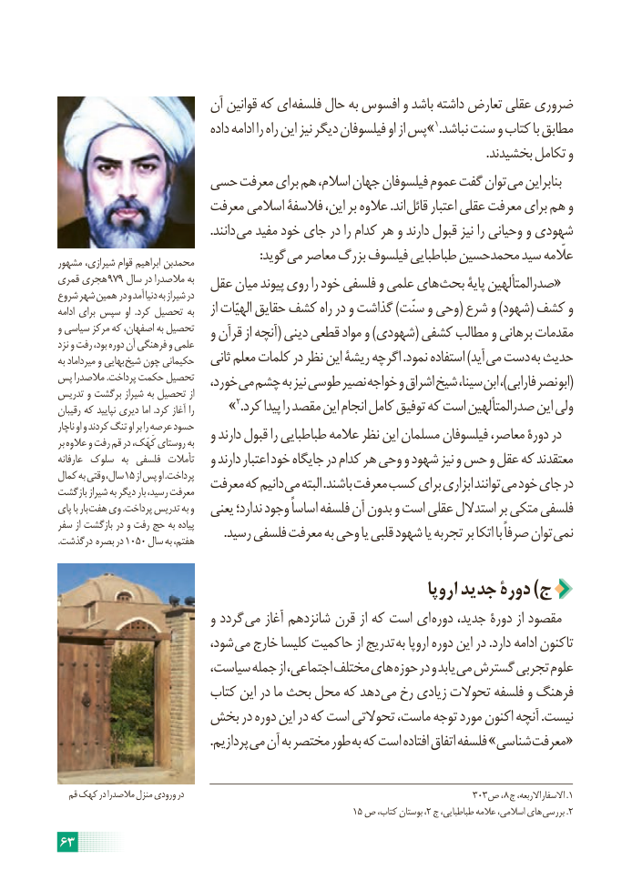

# PDF page 69

آن قوانین که ای فلسفه حال به افسوس و باشد داشته تعارض عقلی ضروری
                                داده ادامه را راه این نیز دیگر فیلسوفان او از پس» 1.نباشد سنت و کتاب با مطابق
                                                                                                                                          .بخشیدند تکامل و
                 حسی معرفت برای هم اسالم، جهان فیلسوفان عموم گفت توان می بنابراین
                      معرفت اسالمی فالسفۀ این، بر عالوه .اند قائل اعتبار عقلی معرفت برای هم و
                                                 .دانند می مفید خود جای در را کدام هر و دارند قبول نیز را وحیانی و شهودی
             : گوید می معاصر بزرگ فیلسوف طباطبایی محمدحسین سید علّمهمشهور شیرازی، قوام ابراهیم محمدبن
قمری هجری 979 سال در مالصدرا به  عقل میان پیوند روی را خود فلسفی و علمی های «بحث پایۀ صدرالمتألهینشروع شهر همین در و آمد دنیا به شیراز در
ادامه برای سپس او  .کرد تحصیل به    از الهیّات حقایق کشف راه در و گذاشت )سنّت و وحی( شرع و )شهود( کشف و
و سیاسی مرکز که اصفهان، به تحصیل   و قرآن از آنچه( دینی قطعی مواد و )شهودی( کشفی مطالب و برهانی مقدماتنزد و رفت بود، دوره آن فرهنگی و علمی
به میرداماد و بهایی شیخ چون حکیمانی   ثانی معلم کلمات در نظر این ریشۀ اگرچه .نمود استفاده )آید می دست به حدیث
پس مالصدرا .پرداخت حکمت تحصیل   خورد، می چشم به نیز طوسی نصیر خواجه و اشراق شیخ سینا، ابن ،)فارابی نصر (ابوتدریس و برگشت شیراز به تحصیل از
رقیبان که نپایید دیری اما .کرد آغاز را       »2.کرد پیدا را مقصد این انجام کامل توفیق که است صدرالمتألهین این ولی
ناچار او و کردند تنگ او بر را عرصه حسود                           و دارند قبول را طباطبایی عالمه نظر این مسلمان فیلسوفان معاصر، دورۀ دربر عالوه و رفت قم در کَهَک، روستای به
عارفانه سلوک  به فلسفی  تأمالت   و دارند اعتبار خود جایگاه در کدام هر وحی و شهود نیز و حس و عقل که معتقدند
کمال به وقتی سال، 15 از پس او .پرداخت                      معرفت که دانیم می البته .باشند معرفت کسب برای ابزاری توانند می خود جای دربازگشت شیراز به دیگر بار رسید، معرفت
پای با بار هفت وی .پرداخت تدریس به و   یعنی ندارد؛ وجود اساساً فلسفه آن بدون و است عقلی استدالل بر متکی فلسفی
سفر از بازگشت در و رفت حج به پیاده . رسید فلسفی معرفت به وحی یا قلبی شهود یا تجربه بر اتکا با صرفاً توان نمی.1050درگذشت بصره در     سال به هفتم،

                                                            اروپا جدید دورۀ )ج
                           و گردد می آغاز شانزدهم قرن از که است ای دوره جدید، دورۀ از مقصود
                          شود، می خارج کلیسا حاکمیت از تدریج به اروپا دوره این در .دارد ادامه تاکنون
                       سیاست، جمله از اجتماعی، مختلف های حوزه در و یابد می گسترش تجربی علوم
                       کتاب این در ما بحث محل که دهد می رخ زیادی تحوالت فلسفه و فرهنگ
                بخش در دوره این در که است تحوالتی ماست، توجه مورد اکنون آنچه .نیست
       . پردازیم می آن به مختصر طور به که است افتاده اتفاق فلسفه »شناسی «معرفت

  قم کهک در مالصدرا منزل ورودی در                                                           303ص ، 8 ج االربعه،  .االسفار 1
                                                            15 ص کتاب، بوستان ،2 ج طباطبایی، عالمه اسالمی، های .بررسی 2
63

