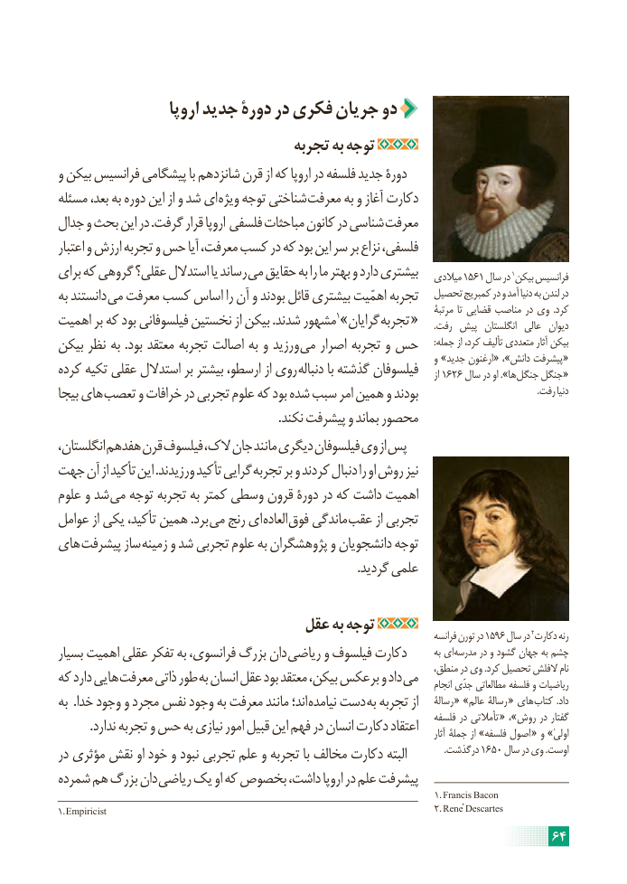

# PDF page 70

اروپا جدید دورۀ در فکری جریان دو
                                 تجربه به توجه
و بیکن فرانسیس پیشگامی با شانزدهم قرن از که اروپا در فلسفه جدید دورۀ
مسئله بعد، به دوره این از و شد ای ویژه توجه شناختی معرفت به و آغاز دکارت
جدال و بحث این در .گرفت قرار اروپا فلسفی مباحثات کانون در شناسی معرفت
اعتبار و ارزش تجربه و حس آیا معرفت، کسب در که بود این سر بر نزاع فلسفی،

                                                                                                                                                1برای که گروهی عقلی؟ استدالل یا رساند می حقایق به را ما بهتر و دارد بیشتری   میالدی 1561 سال در بیکن فرانسیس
به دانستند می معرفت کسب اساس را آن و بودند قائل بیشتری اهمّیت تجربه   تحصیل کمبریج در و آمد دنیا به لندن در
                                                                                                 مرتبۀ تا قضایی مناصب در وی  .کرد
اهمیت بر که بود فیلسوفانی نخستین از بیکن .شدند مشهور1»گرایان تجربه «       .رفت پیش  انگلستان  عالی  دیوان
بیکن نظر به .بود معتقد تجربه اصالت به و ورزید می اصرار تجربه و حس       :جمله از کرد، تألیف متعددی آثار بیکن
                                                                                         و »جدید ارغنون « ،»دانش پیشرفت «
کرده تکیه عقلی استدالل بر بیشتر ارسطو، از روی دنباله با گذشته فیلسوفان      از 1626 سال در او ».ها جنگل جنگل «
بیجا های تعصب و خرافات در تجربی علوم که بود شده سبب امر همین و بودند                                                    .رفت دنیا
                                                                        .نکند پیشرفت و بماند محصور
انگلستان، هفدهم قرن فیلسوف الک، جان مانند دیگری فیلسوفان وی از پس
جهت آن از تأکید این .ورزیدند تأکید گرایی تجربه بر و کردند دنبال را او روش نیز
علوم و شد می توجه تجربه به کمتر وسطی قرون دورۀ در که داشت اهمیت
عوامل از یکی تأکید، همین .برد می رنج ای العاده فوق ماندگی عقب از تجربی
های پیشرفت ساز زمینه و شد تجربی علوم به پژوهشگران و دانشجویان توجه
                                                                                                 .گردید علمی

                              عقل به توجه                                                    2                                                                                                   فرانسه تورن در 1596 سال در دکارت رنه
بسیار اهمیت عقلی تفکر به فرانسوی، بزرگ دان ریاضی و فیلسوف دکارت        به ای مدرسه در و گشود جهان به چشم
                                                                              منطق، در وی .کرد تحصیل الفلش نامکه دارد هایی معرفت ذاتی طور به انسان عقل بود معتقد بیکن، برعکس و داد می                                                                                                         انجام جدّی مطالعاتی فلسفه و ریاضیات
به  .خدا وجود و مجرد نفس وجود به معرفت مانند اند؛ نیامده دست به تجربه از    رسالۀ « »عالم رسالۀ « های کتاب .داد
                                                                                     فلسفه در تأمالتی « ،»روش در گفتار          .ندارد تجربه و حس به نیازی امور قبیل این فهم در انسان دکارت اعتقاد                                                                                                                                 آثار جملۀ از »فلسفه اصول « و »اولیٰ
در مؤثری نقش او خود و نبود تجربی علم و تجربه با مخالف دکارت البته   .1650درگذشت     سال در وی .اوست
شمرده هم بزرگ دان ریاضی یک او که بخصوص داشت، اروپا در علم پیشرفت
                                                                                                             1.  Francis Bacon
1. Empiricist                                                                                                     2. René  Descartes
                                                                     64

