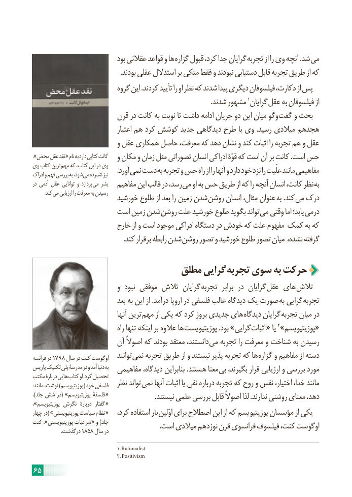

# PDF page 71

بود عقالنی قواعد و ها گزاره قبول کرد، جدا گرایان تجربه از را وی آنچه .شد می
                                                   .بودند عقلی استدالل بر متکی فقط و نبودند دستیابی قابل تجربه طریق از که
                          گروه این .کردند تأیید را او نظر که شدند پیدا دیگری فیلسوفان دکارت، از پس
         .1شدند مشهور گرایان عقل به فیلسوفان از
                      قرن در کانت به نوبت تا داشت ادامه جریان دو این میان وگو گفت و بحث
                                  اعتبار هم کرد کوشش جدید دیدگاهی طرح با وی .رسید میالدی هجدهم
                           و عقل همکاری حاصل معرفت، که دهد نشان و کند اثبات را تجربه هم و عقل
.»محض عقل نقد « نام به دارد کتابی کانت   و مکان و زمان مثل تصوراتی انسان ادراکی قوّۀ که است آن بر کانت .است حس
وی کتاب ترین مهم که کتاب، این در وی                                                 .آورد نمی دست به تجربه و حس راه از را آنها و دارد خود نزد را علّیت مانند مفاهیمیادراک و فهم بررسی به شود، می شمرده نیز
در آدمی عقل توانایی و پردازد می بشر   مفاهیم این قالب در رسد، می او به حس طریق از که را آنچه انسان کانت، نظر به
  . کند می ارزیابی را معرفت به رسیدن                        خورشید طلوع از بعد را زمین شدن روشن انسان مثال، عنوان به .کند می درک
                    است زمین شدن روشن علت خورشید طلوع بگوید تواند می وقتی اما یابد؛ درمی
                         خارج از و است موجود ادراکی دستگاه در خودش که علت مفهوم کمک به که
   . کند برقرار رابطه شدن روشن تصور و خورشید طلوع تصور میان  ،گرفتهنشده

                             مطلق گرایی  تجربه سوی به حرکت
                           و  نبود موفقی تالش گرایان  تجربه  برابر در گرایان  عقل های تالش
                              بعد به این از .درآمد اروپا در فلسفی غالب دیدگاه یک صورت به گرایی تجربه
                                   آنها ترین مهم از یکی که کرد بروز جدیدی های دیدگاه گرایان تجربه میان در
                                   راه تنها اینکه بر عالوه ها پوزیتیویست .بود »گرایی اثبات « یا 2»«پوزیتیویسم
                       آن اصوالً که بودند معتقد دانستند، می تجربه را معرفت و شناخت به رسیدن
فرانسه در 1798 سال در کنت اوگوست   توانند نمی تجربه طریق از و نیستند پذیر تجربه که ها گزاره و مفاهیم از دسته
پاریس تکنیک پلی مدرسۀ در و آمد دنیا به  مفاهیمی دیدگاه، بنابراین .هستند معنا بی بگیرند، قرار ارزیابی و بررسی مورد
مکتب دربارۀ هایی کتاب او .کرد تحصیل
:مانند نوشت، )پوزیتیویسم( خود فلسفی  نظر تواند نمی آنها اثبات یا نفی درباره تجربه که روح و نفس اختیار، خدا، مانند
،)جلد شش در( »پوزیتیویسم فلسفۀ «                           .نیستند علمی بررسی قابل اصوالً لذا .ندارند روشنی معنای دهد،
،»پوزیتیویسم نگرش  دربارۀ  گفتار «
چهار در( »پوزیتیویستی سیاست نظام «   کرد، استفاده بار اوّلین برای اصطالح این از که پوزیتیویسم مؤسسان از یکی
کنت ».پوزیتیویستی شرعیات « و )جلد                                                                          .است میالدی نوزدهم قرن فرانسوی فیلسوف کنت، اوگوست    .1858درگذشت     سال در

                                           1. Rationalist
                                           2. Positivism
65

