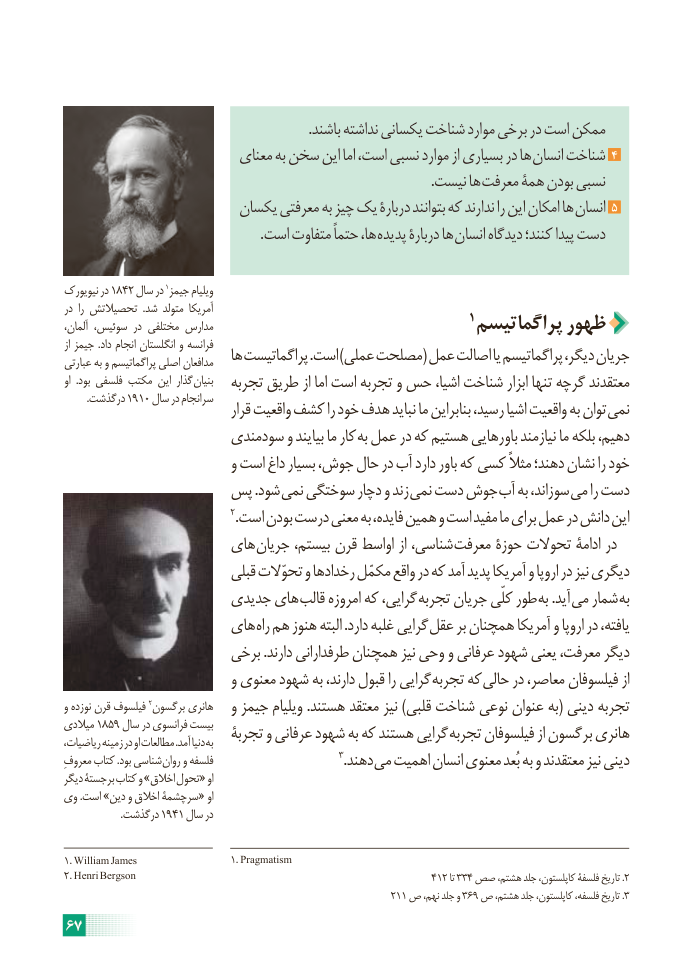

# PDF page 73

.باشند نداشته یکسانی شناخت موارد برخی در است ممکن
                          معنای به سخن این اما است، نسبی موارد از بسیاری در ها انسان شناخت 4
                                                                                                            .نیست ها معرفت همۀ بودن نسبی
                       یکسان معرفتی به چیز یک دربارۀ بتوانند که ندارند را این امکان ها انسان 5
                                                          .است متفاوت حتماً ها، پدیده دربارۀ ها انسان دیدگاه کنند؛ پیدا دست

نیویورک در 1842 سال در 1جیمز ویلیام
در  را تحصیالتش  .شد متولد آمریکا                                                          1آلمان، سوئیس، در مختلفی مدارس                              پراگماتیسم ظهور
از جیمز .داد انجام انگلستان و فرانسه
عبارتی به و پراگماتیسم اصلی مدافعان   ها پراگماتیست .است )عملی مصلحت( عمل اصالت یا پراگماتیسم دیگر، جریان
او  .بود فلسفی مکتب این گذار بنیان   تجربه طریق از اما است تجربه و حس اشیا، شناخت ابزار تنها گرچه معتقدند
  .1910درگذشت     سال در سرانجام
                                 قرار واقعیت کشف را خود هدف نباید ما بنابراین رسید، اشیا واقعیت به توان نمی
                      سودمندی و بیایند ما کار به عمل در که هستیم باورهایی نیازمند ما بلکه دهیم،
                           و است داغ بسیار جوش، حال در آب دارد باور که کسی مثالً دهند؛ نشان را خود
               پس .شود نمی سوختگی دچار و زند نمی دست جوش آب به سوزاند، می را دست
                                          2.است بودن درست معنی به فایده، همین و است مفید ما برای عمل در دانش این
                    های جریان بیستم، قرن اواسط از شناسی، معرفت حوزۀ تحوالت ادامۀ در
                           قبلی تحوّالت و رخدادها مکمّل واقع در که آمد پدید آمریکا و اروپا در نیز دیگری
                     جدیدی های قالب امروزه که گرایی، تجربه جریان کلّی طور به .آید می شمار به
                    های راه هم هنوز البته .دارد غلبه گرایی عقل بر همچنان آمریکا و اروپا در یافته،
                      برخی .دارند طرفدارانی همچنان نیز وحی و عرفانی شهود یعنی معرفت، دیگر
                           و معنوی شهود به دارند، قبول را گرایی تجربه که حالی در معاصر، فیلسوفان از
و نوزده قرن فیلسوف 2برگسون هانری   و جیمز ویلیام .هستند معتقد نیز )قلبی شناخت نوعی عنوان به( دینی تجربه
میالدی 1859 سال در فرانسوی بیست                          تجربۀ و عرفانی شهود به که هستند گرایی تجربه فیلسوفان از برگسون هانریریاضیات، زمینه در او مطالعات .آمد دنیا به
معروفِ کتاب .بود شناسی روان و فلسفه                                3.دهند می اهمیت انسان معنوی بُعد به و معتقدند نیز دینی
دیگر برجستۀ کتاب و »اخالق تحول« او
وی .است »دین و اخالق سرچشمۀ« او
    .1941درگذشت     سال در

1. William James                          1. Pragmatism
2. Henri Bergson                                                       412 تا 334 صص هشتم، جلد کاپلستون، فلسفۀ تاریخ .2
                                                             211 ص نهم، جلد و 369 ص هشتم، جلد کاپلستون، فلسفه، تاریخ .3
67

