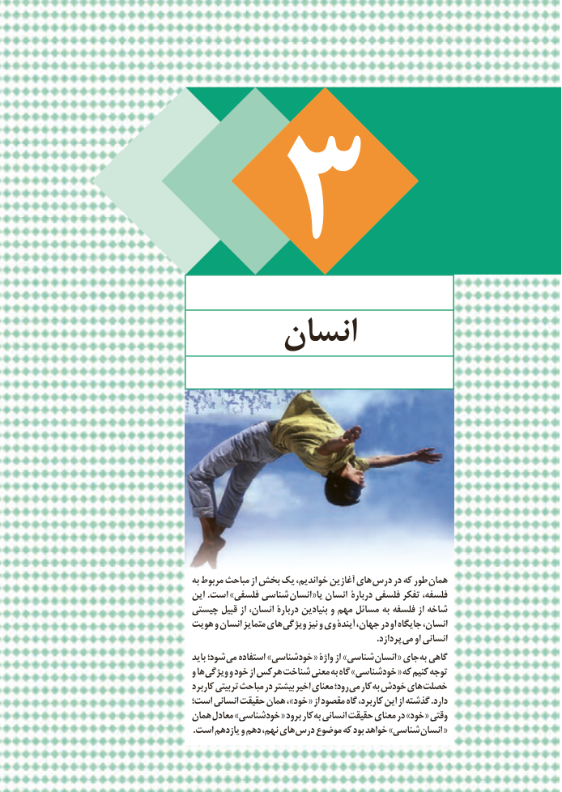

# PDF page 75

انسان

                                     به مربوط مباحث از بخش یک خواندیم، آغازین های  درس در که طور  همان
                                این .است »فلسفی شناسی  انسان  «یا انسان  دربارۀ فلسفی تفکر فلسفه،
                          چیستی قبیل از انسان، دربارۀ بنیادین و مهم مسائل به فلسفه از شاخه
                          هویت و انسان متمایز های ویژگی نیز و وی آیندۀ جهان، در او جایگاه انسان،
                                                                                                                                    .پردازد می او انسانی
                                        باید شود؛ می استفاده »خودشناسی « واژۀ از »شناسی انسان « جای به گاهی
                                  و ها ویژگی و خود از هرکس شناخت معنی به گاه »خودشناسی « که کنیم توجه
                                     کاربرد تربیتی مباحث در بیشتر اخیر معنای رود؛ می کار به خودش های خصلت
                           است؛ انسانی حقیقت همان ، »خود « از مقصود گاه کاربرد، این از گذشته .دارد
                             همان معادل »خودشناسی « برود کار به انسانی حقیقت معنای در »خود « وقتی
   . است یازدهم و دهم نهم، های درس موضوع که بود خواهد »شناسی انسان «
69

