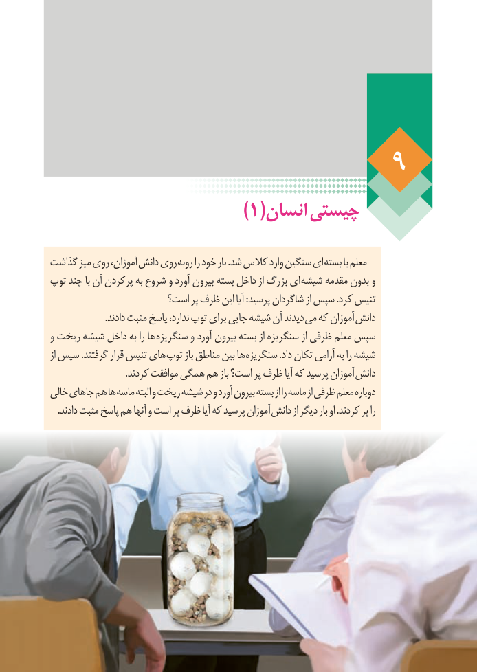

# PDF page 76

)1(انسان چیستی

گذاشت میز روی آموزان، دانش روی روبه را خود بار .شد کالس وارد سنگین ای بسته با معلم
توپ چند با آن پرکردن به شروع و آورد بیرون بسته داخل از بزرگ ای شیشه مقدمه بدون و
                      است؟ پر ظرف این آیا :پرسید شاگردان از سپس .کرد تنیس
                       .دادند مثبت پاسخ ندارد، توپ برای جایی شیشه آن دیدند می که آموزان دانش
و ریخت شیشه داخل به را ها سنگریزه و آورد بیرون بسته از سنگریزه از ظرفی معلم سپس
از سپس .گرفتند قرار تنیس های توپ باز مناطق بین ها سنگریزه .داد تکان آرامی به را شیشه
 . کردند موافقت همگی هم باز است؟ پر ظرف آیا که پرسید آموزان دانش
خالی جاهای هم ها ماسه البته و ریخت شیشه در و آورد بیرون بسته از را ماسه از ظرفی معلم دوباره
. دادند مثبت پاسخ هم آنها و است پر ظرف آیا که پرسید آموزان دانش از دیگر بار او .کردند پر را

                                                                    70

