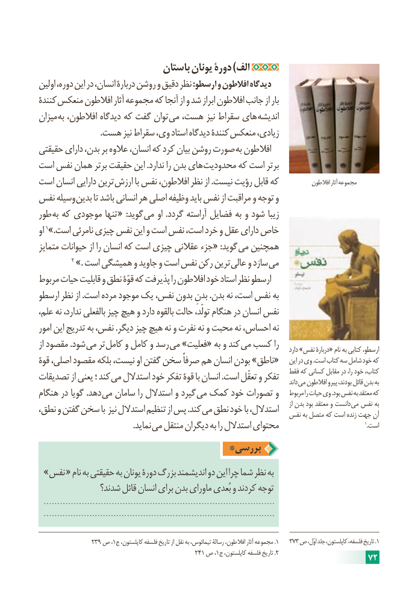

# PDF page 78

باستان یونان دورۀ )الف
اولین دوره، این در انسان، دربارۀ روشن و دقیق نظر :ارسطو و افالطون دیدگاه
کنندۀ منعکس افالطون آثار مجموعه که آنجا از و شد ابراز افالطون جانب از بار
میزان به افالطون، دیدگاه که گفت توان می هست، نیز سقراط های اندیشه
 . هست نیز سقراط وی، استاد دیدگاه کنندۀ منعکس زیادی،
حقیقتی دارای بدن، بر عالوه انسان، که کرد بیان روشن صورت به افالطون
است نفس همان برتر حقیقت این .ندارد را بدن های محدودیت که است برتر
است انسان دارایی ترین ارزش با نفس افالطون، نظر از .نیست رؤیت قابل که            افالطون آثار مجموعه
نفس وسیله بدین تا باشد انسانی هر اصلی وظیفه باید نفس از مراقبت و توجه و
طور به که موجودی تنها « :گوید می او .گردد آراسته فضایل به و شود زیبا
او 1».است نامرئی چیزی نفس این و است نفس است، خرد و عقل دارای خاص
متمایز حیوانات از را انسان که است چیزی عقالنی جزء« :گوید می همچنین
            2 ». است همیشگی و جاوید و است نفس رکن ترین عالی و سازد می
مربوط حیات قابلیت و نطق قوّۀ که پذیرفت را افالطون خود استاد نظر ارسطو
ارسطو نظر از .است مرده موجود یک نفس، بدون بدنِ .بدن نه است، نفس به
علم، نه ندارد، بالفعلی چیز هیچ و دارد بالقوه حالت تولّد، هنگام در انسان نفس
امور این تدریج به نفس، .دیگر چیز هیچ نه و نفرت نه و محبت نه احساس، نه
از مقصود .شود می تر کامل و کامل و رسد می »فعلیت« به و کند می کسب را                                                                                                              دارد »نفس دربارۀ« نام به کتابی ارسطو،
قوۀ اصلی، مقصود بلکه نیست، او گفتن سخن صرفاً هم انسان بودن »ناطق«    این در وی .است کتاب سه شامل خود که
تصدیقات از یعنی ؛ کند می استدالل خود تفکر قوۀ با انسان .است تعقّل و تفکر   فقط که کسانی مقابل در را، خود کتاب،                                                                                                                   داند می افالطون پیرو بودند، قائل بدن به
هنگام در گویا .دهد می سامان را استدالل و گیرد می کمک خود تصورات و   مربوط را حیات وی .بود نفس به معتقد که
نطق، و گفتن سخن با نیز استدالل تنظیم از پس .کند می نطق خود با استدالل،     از بدن بود معتقد و دانست می نفس به                                                               نفس به متصل که است زنده جهت آن
         . نماید می منتقل دیگران به را استدالل محتوای                                                  1.است
                                 *بررسی
 »نفس « نام به حقیقتی به یونان دورۀ بزرگ اندیشمند دو این چرا شما نظر به
               شدند؟ قائل انسان برای بدن ماورای بُعدی و کردند توجه
  .....................................................................................
  ......................................................................................

                239 ص ،1.ج کاپلستون، فلسفه تاریخ از نقل به تیمائوس، رسالۀ افالطون، آثار مجموعه 1   373 ص اوّل، جلد کاپلستون، فلسفه، تاریخ . 1
                                                241 ص ،1.ج کاپلستون، فلسفه تاریخ 2                                                                     72

