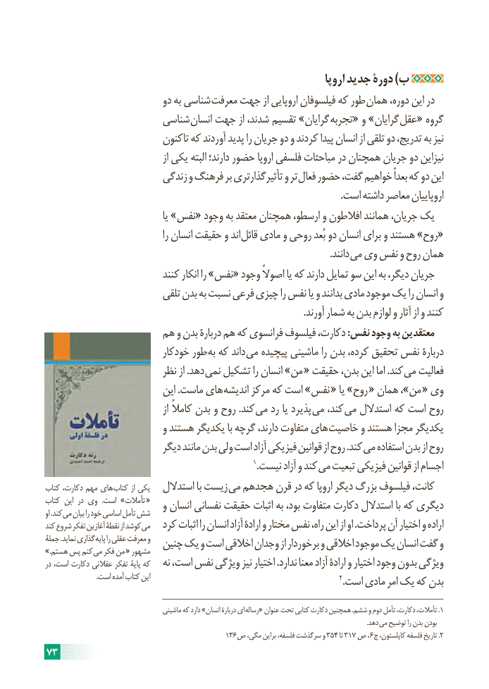

# PDF page 79

اروپا جدید دورۀ )ب
                           دو به شناسی معرفت جهت از اروپایی فیلسوفان که طور همان دوره، این در
                      شناسی انسان جهت از شدند، تقسیم »گرایان تجربه« و »گرایان عقل« گروه
                           تاکنون که آوردند پدید را جریان دو و کردند پیدا انسان از تلقی دو تدریج، به نیز
                                        از یکی البته دارند؛ حضور اروپا فلسفی مباحثات در همچنان جریان دو نیزاین
                        زندگی و فرهنگ بر تأثیرگذارتری و تر فعال حضور گفت، خواهیم بعداً که دو این
                                                                                                                           .است داشته معاصر اروپاییان
                                        یا »نفس« وجود به معتقد همچنان ارسطو، و افالطون همانند جریان، یک
                                        را انسان حقیقت و اند «قائل مادی و روحی بُعد دو انسان برای و هستند »روح
                         . دانند می وی نفس و روح همان
                           کنند انکار را »نفس« وجود اصوالً یا که دارند تمایل سو این به دیگر، جریان
                          تلقی بدن به نسبت فرعی چیزی را نفس یا و بدانند مادی موجود یک را انسان و
                                                                                                            .آورند شمار به بدن لوازم و آثار از و کنند
                   هم و بدن دربارۀ هم که فرانسوی فیلسوف دکارت، :نفس وجود به معتقدین
                          خودکار طور به که داند می پیچیده ماشینی را بدن کرده، تحقیق نفس دربارۀ
                         نظر از .دهد نمی تشکیل را انسان »من « حقیقت بدن، این اما .کند می فعالیت
                           این .ماست های اندیشه مرکز که است »نفس « یا »روح « همان ،»من « وی
                                        از کامالً بدن و روح .کند می رد یا پذیرد می کند، می استدالل که است روح
                           و هستند یکدیگر با گرچه دارند، متفاوت های خاصیت و هستند مجزا یکدیگر
                         دیگر مانند بدن ولی است آزاد فیزیکی قوانین از روح .کند می استفاده بدن از روح
                                                                          1.نیست آزاد و کند می تبعیت فیزیکی قوانین از اجسام
کتاب دکارت، مهم های کتاب از یکی   استدالل با زیست می هجدهم قرن در که اروپا دیگر بزرگ فیلسوف کانت،
کتاب این در وی  .است »تأمالت «   و انسان نفسانی حقیقت اثبات به بود، متفاوت دکارت استدالل با که دیگریاو .کند می بیان را خود اساسی تأمل شش
کند شروع تفکر آغازین نقطۀ از کوشد می   کرد اثبات را انسان آزاد ارادۀ و مختار نفس راه، این از او .پرداخت آن اختیار و اراده
جملۀ .نماید گذاری پایه را عقلی معرفت و  چنین یک و است اخالقی وجدان از برخوردار و اخالقی موجود یک انسان گفت و.»هستم پس کنم می فکر من « مشهور
در است، دکارت عقالنی تفکر پایۀ که   نه است، نفس ویژگی نیز اختیار .ندارد معنا آزاد ارادۀ و اختیار وجود بدون ویژگی
                             .است آمده کتاب این                                                                   2.است مادی امر یک که بدن

                                     ماشینی که دارد »انسان دربارۀ ای رساله« عنوان تحت کتابی دکارت همچنین .ششم و دوم تأمل دکارت، تأمالت، .1
                                                                                                                                                                                                         .دهد می توضیح را بدن بودن
                                               136ص مگی، براین فلسفه، سرگذشت و 354 تا 317 ص ،  6.ج کاپلستون، فلسفه تاریخ 2
73

