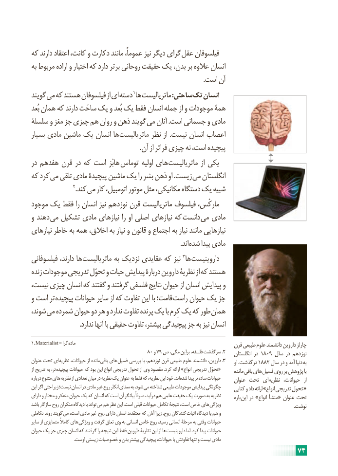

# PDF page 80

که دارند اعتقاد کانت، و دکارت مانند عموماً، نیز دیگر گرای عقل فیلسوفان
به مربوط اراده و اختیار که دارد برتر روحانی حقیقت یک بدن، بر عالوه انسان
                                                                                                        .است آن
گویند می که هستند فیلسوفان از ای دسته 1ها ماتریالیست :ساحتی تک انسان
بُعد همان که دارند ساحَت یک و بُعد یک فقط انسان جمله از و موجودات همۀ
سلسلۀ و مغز جز چیزی هم روان و ذهن گویند می آنان .است جسمانی و مادی
بسیار مادی ماشین یک انسان ها ماتریالیست نظر از .نیست انسان اعصاب
                                                                 .آن از فراتر چیزی نه است، پیچیده
در هفدهم قرن در که است هابْز توماس اولیه های ماتریالیست از یکی
که کرد می تلقی مادی پیچیدۀ ماشین یک را بشر ذهن او .زیست می انگلستان
                      2.کند می کار اتومبیل، موتور مثل مکانیکی، دستگاه یک شبیه
موجود یک فقط را انسان نیز نوزدهم قرن ماتریالیست فیلسوف مارکْس،
و دهند می تشکیل مادی نیازهای را او اصلی نیازهای که دانست می مادی
نیازهای خاطر به همه اخالق، به نیاز و قانون و اجتماع به نیاز مانند نیازهایی
                            . اند شده پیدا مادی
فیلسوفانی دارند، ها ماتریالیست به نزدیک عقایدی که نیز 3ها داروینیست
زنده موجودات تدریجی تحوّل و حیات پیدایش دربارۀ داروین نظریۀ از که هستند
نیست، چیزی انسان که گفتند و گرفتند فلسفی نتایج حیوان از انسان پیدایش و
و است تر پیچیده حیوانات سایر از که تفاوت این با قامت؛ راست حیوان یک جز
شوند، می شمرده حیوان دو هر و ندارد تفاوت پرنده یک با کِرم یک که طور همان
                             .ندارد آنها با حقیقی تفاوت بیشتر، پیچیدگی جز به نیز انسان
1. Materialist = گرا ماده                                                          قرن طبیعی علوم دانشمند داروین چارلز
                                            80 و 79 ص مگی، براین فلسفه، سرگذشت .2    انگلستان در 1809 سال در نوزدهم
عنوان تحت ای نظریه حیوانات، از مانده باقی های فسیل بررسی با نوزدهم، قرن طبیعی علوم دانشمند داروین، .3     او .درگذشت 1882 سال در و آمد دنیا به
از تدریج به تر، «پیچیده حیوانات که بود این انواع تدریجی تحول از وی مقصود .کرد ارائه »انواع تدریجی تحوّل        مانده باقی های فسیل روی بر پژوهش با
درباره متنوع های نظریه از تعدادی میان در نظریه یک عنوان به فقط که نظریه، این خود .اند شده پیدا تر ساده حیوانات      عنوان تحت ای نظریه  حیوانات،  از
این اگر حتی زیرا نیست؛ انسان در مادی غیر روح انکار معنای به شود، می شناخته طبیعی موجودات پیدایش چگونگی      کتابی و داد ارائه »انواع تدریجی تحول «
دارای و مختار و متفکر حیوان یک که انسان که است آن بیانگر صرفاً درآید، هم علمی حقیقت یک صورت به نظریه        باره این در »انواع منشأ« عنوان تحت
باشد سازگار روح منکران دیدگاه با تواند می هم نظر این .است قبلی حیوانات تکامل نتیجۀ است، خاص های ویژگی                                                           .نوشت
تکاملی روند گویند می است، مادی غیر روح دارای انسان معتقدند که آنان زیرا .روح کنندگان اثبات دیدگاه با هم و
سایر از متمایزی کامالً های ویژگی و گرفت تعلق وی به انسانی خاص روح رسید، انسانی مرحلۀ به وقتی حیوانات
حیوان یک جز چیزی انسان که گرفتند را نتیجه این فقط داروین نظریۀ این از ها داروینیست اما .کرد پیدا حیوانات
                                      .اوست زیستی خصوصیات و بدن بیشتر پیچیدگی حیوانات، با تفاوتش تنها و نیست مادی
                                                                     74

