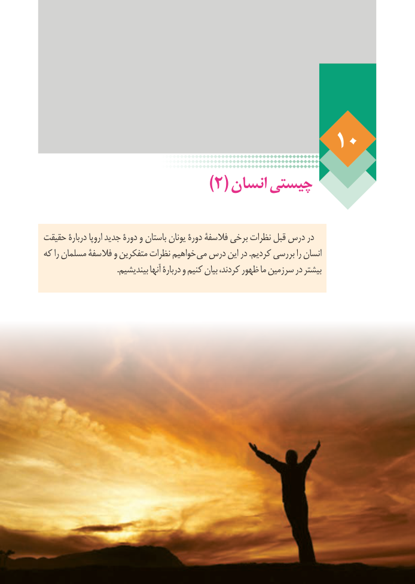

# PDF page 82

)2( انسان چیستی

حقیقت دربارۀ اروپا جدید دورۀ و باستان یونان دورۀ فالسفۀ برخی نظرات قبل درس در
که را مسلمان فالسفۀ و متفکرین نظرات خواهیم می درس این در .کردیم بررسی را انسان
                                    .بیندیشیم آنها دربارۀ و کنیم بیان کردند، ظهور ما سرزمین در بیشتر

                                                                    76

