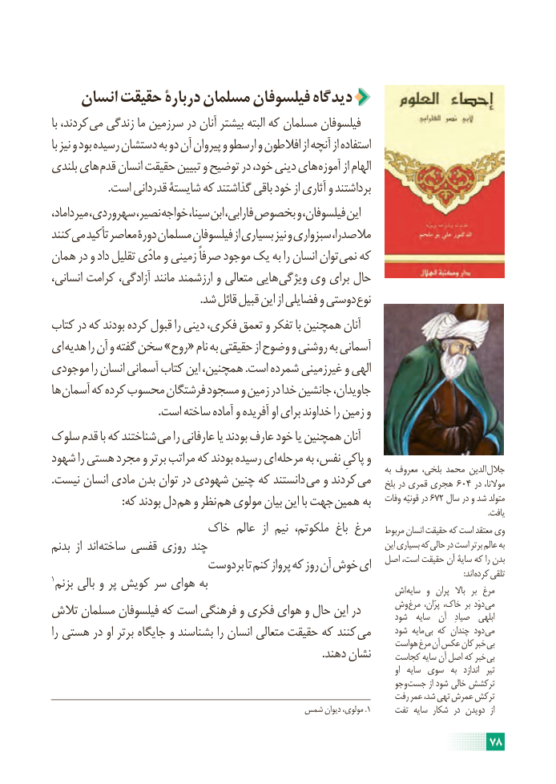

# PDF page 84

انسان حقیقت دربارۀ مسلمان فیلسوفان دیدگاه
با کردند، می زندگی ما سرزمین در آنان بیشتر البته که مسلمان فیلسوفان
با نیز و بود رسیده دستشان به دو آن پیروان و ارسطو و افالطون از آنچه از استفاده
بلندی های قدم انسان حقیقت تبیین و توضیح در خود، دینی های آموزه از الهام
                     .است قدردانی شایستۀ که گذاشتند باقی خود از آثاری و برداشتند
میرداماد، سهروردی، نصیر، خواجه سینا، ابن فارابی، بخصوص و فیلسوفان، این
کنند می تأکید معاصر دورۀ مسلمان فیلسوفان از بسیاری نیز و سبزواری مالصدرا،
همان در و داد تقلیل مادّی و زمینی صرفاً موجود یک به را انسان توان نمی که
انسانی، کرامت آزادگی، مانند ارزشمند و متعالی هایی ویژگی وی برای حال
  . شد قائل قبیل این از فضایلی و دوستی نوع
کتاب در که بودند کرده قبول را دینی فکری، تعمق و تفکر با همچنین آنان
ای هدیه را آن و گفته سخن »روح« نام به حقیقتی از وضوح و روشنی به آسمانی
موجودی را انسان آسمانی کتاب این همچنین، .است شمرده غیرزمینی و الهی
ها آسمان که کرده محسوب فرشتگان مسجود و زمین در خدا جانشین جاویدان،
                                       .است ساخته آماده و آفریده او برای خداوند را زمین و
سلوک قدم با که شناختند  می را عارفانی یا بودند عارف خود یا همچنین آنان
شهود را هستی مجرد و برتر مراتب که بودند رسیده ای مرحله به نفس، پاکیِ و
                                                                                                      به معروف بلخی، محمد الدین  جالل
.نیست انسان مادی بدن توان در شهودی چنین که دانستند می و کردند می    بلخ در قمری هجری   604 در موالنا،
  : که بودند دل هم و نظر  هم مولوی بیان این با جهت  همین به   وفات قونیّه در 672 سال در و شد متولد
                                                                                                                                                                                                                               .یافت
                     خاک عالم  از نیم ملکوتم، باغ مرغ   مربوط انسان حقیقت که است معتقد وی
بدنم  از اند ساخته قفسی روزی چند                                                   این بسیاری که حالی در است برتر عالم به
                          بردوست تا کنم پرواز که روز آن خوش ای   اصل است، حقیقت آن سایۀ که را بدن1                                                                 : اند کرده تلقی بزنم بالی و پر کویش سر هوای به                                                              اش سایه  و  پران  باال  بر مرغ
تالش مسلمان فیلسوفان که است فرهنگی و فکری هوای و حال این در     وش مرغ پرّان، خاک، بر دوَد می                                                                                  شود  سایه  آن   صیادِ  ابلهی
را هستی در او برتر جایگاه و بشناسند را انسان متعالی حقیقت که کنند  می      شود مایه بی که چندان دود می
                                                                           هواست مرغ آن عکس کان خبر بی
                                                                                                   .دهند نشان     کجاست سایه آن اصل که خبر بی
                                                                                                                                        او  سایه سوی  به   اندازد  تیر
                                                                               جو و جست از شود خالی ترکشش
                                                                          رفت عمر شد، تهی عمرش ترکش
                                         شمس دیوان مولوی، .1     تفت سایه شکار  در دویدن  از

                                                                     78

