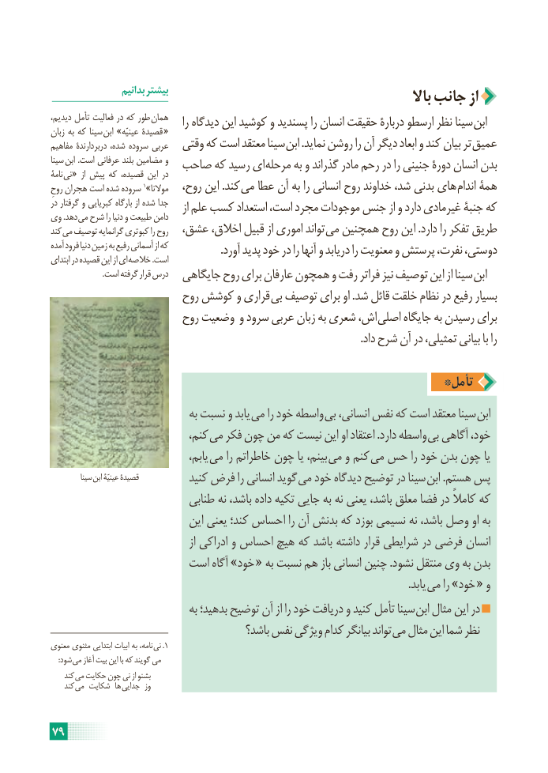

# PDF page 85

بدانیم بیشتر                                                    باال جانب از
دیدیم، تأمل فعالیت در که طور همان    را دیدگاه این کوشید و پسندید را انسان حقیقت دربارۀ ارسطو نظر سینا ابنزبان به که سینا ابن »عینیّه قصیدۀ  «
مفاهیم دربردارندۀ شده، سروده عربی  وقتی که است معتقد سینا ابن .نماید روشن را آن دیگر ابعاد و کند بیان تر عمیق
سینا ابن .است عرفانی بلند مضامین و  صاحب که رسید ای مرحله به و گذراند مادر رحم در را جنینی دورۀ انسان بدننامۀ نی «  از پیش که قصیده، این در
روحِ هجران است شده سروده 1»موالنا   روح، این .کند می عطا آن به را انسانی روح خداوند شد، بدنی های اندام همۀ
در گرفتار و کبریایی بارگاه از شده جدا    از علم کسب استعداد است، مجرد موجودات جنس از و دارد غیرمادی جنبۀ کهوی .دهد می شرح را دنیا و طبیعت دامن
کند می توصیف گرانمایه کبوتری را روح  عشق، اخالق، قبیل از اموری تواند می همچنین روح این .دارد را تفکر طریق
آمده فرود دنیا زمین به رفیع آسمانی از که                   .آورد پدید خود در را آنها و دریابد را معنویت و پرستش نفرت، دوستی،ابتدای در قصیده این از ای خالصه .است
                          .است گرفته قرار درس  جایگاهی روح برای عارفان همچون و رفت فراتر نیز توصیف این از سینا ابن
                       روح کوشش و قراری  بی توصیف برای او .شد قائل خلقت نظام در رفیع بسیار
                       روح وضعیت و سرود عربی زبان به شعری اش،  اصلی جایگاه به رسیدن برای
                                                                                                                   .داد شرح آن در تمثیلی، بیانی با را

                                                    *تأمل
                                به نسبت و یابد  می را خود واسطه بی انسانی، نفس که است معتقد سینا ابن
                            کنم، می فکر چون من که نیست این او اعتقاد .دارد واسطه بی آگاهی خود،
                                   یابم، می را خاطراتم چون یا بینم، می و کنم می حس را خود بدن چون یا
          سینا ابن عینیّۀ قصیدۀ          کنید فرض را انسانی گوید می خود دیدگاه توضیح در سینا  ابن .هستم پس
                           طنابی نه باشد، داده تکیه جایی به نه یعنی باشد، معلق فضا در کامالً که
                            این یعنی کند؛ احساس را آن بدنش که بوزد نسیمی نه باشد، وصل او به
                                         از ادراکی و احساس هیچ که باشد داشته قرار شرایطی در فرضی انسان
                    است آگاه »خود « به نسبت هم باز انسانی چنین .نشود منتقل وی به بدن
                                 . یابد می را »خود « و
                                به بدهید؛ توضیح آن از را خود دریافت و کنید تأمل سینا ابن مثال این در
                                         باشد؟ نفس ویژگی کدام بیانگر تواند می مثال این شما نظر
معنوی مثنوی ابتدایی ابیات به نامه،  نی .1
    :شود می آغاز بیت این با که گویند می
    کند  می حکایت چون نی از بشنو
    کند می شکایت ها جدایی  وز

79

