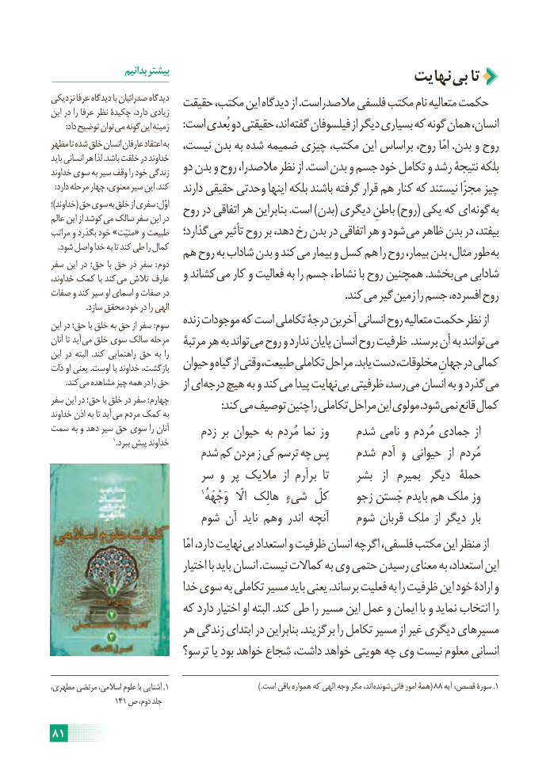

# PDF page 87

بدانیم بیشتر                                 نهایت بی تا
نزدیکی عرفا دیدگاه با صدرائیان دیدگاه  حقیقت مکتب، این دیدگاه از .مالصدراست فلسفی مکتب نام متعالیه حکمتاین در را عرفا نظر چکیدۀ دارد، زیادی
       :داد توضیح توان می گونه این زمینه     :است بُعدی دو حقیقتی اند، گفته فیلسوفان از دیگر بسیاری که گونه همان انسان،
مظهر تا شده خلق انسان عارفان اعتقاد به  نیست، بدن به شده ضمیمه چیزی مکتب، این براساس روح، امّا .بدن و روح
باید انسانی هر لذا .باشد خلقت در خداوند
خداوند سوی به سیر وقف را خود زندگی   دو بدن و روح مالصدرا، نظر از .است بدن و جسم خود تکامل و رشد نتیجۀ بلکه
  :دارد مرحله چهار معنوی، سیر این .کند   دارند حقیقی وحدتی اینها بلکه باشند گرفته قرار هم کنار که نیستند مجزّا چیز
؛)خداوند( حق سوی به خلق از سفری :اوّل  روح در اتفاقی هر بنابراین .است )بدن( دیگری باطنِ )روح( یکی که ای گونه بهعالم این از کوشد می سالک سفر این در
مراتب و بگذرد خود »منیّت« و طبیعت   گذارد؛ می تأثیر روح بر دهد، رخ بدن در اتفاقی هر و شود می ظاهر بدن در بیفتد،
    .شود واصل خدا به تا کند طی را کمال  هم روح به شاداب بدن و کند می بیمار و کسل هم را روح بیمار، بدن مثال، طور به
سفر این در حق؛ با حق در سفر : دوم
خداوند، کمک با کند می تالش عارف   و کشاند می کار و فعالیت به را جسم نشاط، با روح همچنین .بخشد می شادابی
صفات و کند سیر او اسمای و صفات در                . کند می گیر زمین را جسم افسرده، روح
                  .سازد محقق خود در را الهی
این در حق؛ با خلق به حق از سفر : سوم   زنده موجودات که است تکاملی درجۀ آخرین انسانی روح متعالیه حکمت نظر از
آنان تا آید می خلق سوی سالک مرحله   مرتبۀ هر به تواند می روح و ندارد پایان انسان روح ظرفیت .برسند آن به توانند می
این در البته  .کند راهنمایی حق به را
ذات او یعنی .اوست با خداوند بازگشت،   حیوان و گیاه از وقتی طبیعت، تکاملی مراحل .یابد دست مخلوقات، جهانِ در کمالی
  . کند می مشاهده چیز همه در را حق    از ای درجه هیچ به و کند می پیدا نهایت بی ظرفیتی رسد، می انسان به و گذرد می
سفر این در حق؛ با خلق در سفر : چهارم     : کند می توصیف چنین را تکاملی مراحل این مولوی .شود نمی قانع کمالخداوند اذن به تا آید می مردم کمک به
سمت به و دهد سیر حق سوی را آنان      زدم بر حیوان به مُردم نما وز    شدم نامی و مُردم جمادی از
                           1.ببرد پیش خداوند
                          شدم کم مردن ز کی ترسم چه پس    شدم آدم و حیوانی  از مُردم
                        سر و پر مالیک  از برآرم  تا     بشر   از  بمیرم  دیگر  حملۀ
                                        1وَجْهَهُکلّالّ هالِک شیءٍ         زجو جَستن بایدم هم ملک وز
                        شوم آن ناید وهم اندر آنچه    شوم قربان ملک از دیگر بار
                                                    امّا دارد، نهایت بی استعداد و ظرفیت انسان اگرچه فلسفی، مکتب این منظر از
                                 اختیار با باید انسان .نیست کماالت به وی حتمی رسیدن معنای به استعداد، این
                           خدا سوی به تکاملی مسیر باید یعنی .برساند فعلیت به را ظرفیت این خود ارادۀ و
                      که دارد اختیار او البته .کند طی را مسیر این عمل و ایمان با و نماید انتخاب را
                      هر زندگی ابتدای در بنابراین .برگزیند را تکامل مسیر از غیر دیگری مسیرهای
                         ترسو؟ یا بود خواهد شجاع داشت، خواهد هویتی چه وی نیست معلوم انسانی

مطهری، مرتضی اسالمی، علوم با آشنایی .1                                           ).است باقی همواره که الهی  وجه مگر اند، شونده  فانی امور همۀ( 88 آیه قصص، سورۀ .1
                141 ص دوم، جلد

81

