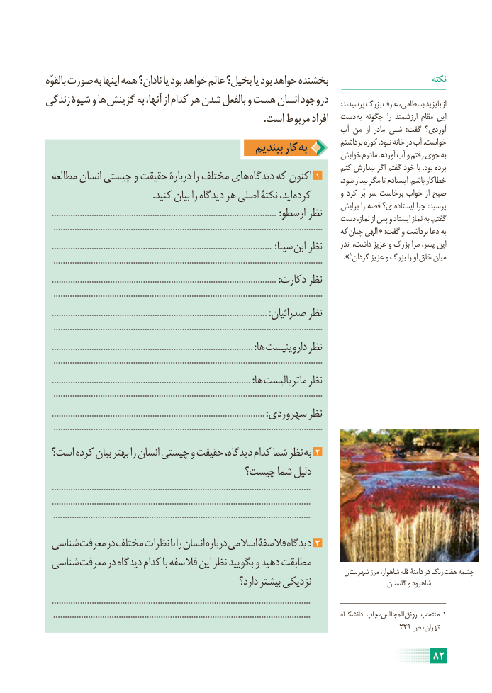

# PDF page 88

بالقوّه صورت به اینها همه نادان؟ یا بود خواهد عالم بخیل؟ یا بود خواهد بخشنده                            نکته
زندگی شیوۀ و ها گزینش به آنها، از کدام هر شدن بالفعل و هست انسان دروجود       :پرسیدند بزرگ عارف بسطامی، بایزید از
                                                                                          .است مربوط افراد  دست به چگونه  را ارزشمند مقام این
                                                                   آب من  از مادر شبی  :گفت آوردی؟
                                             ببندیم کار به          برداشتم کوزه .نبود خانه در آب .خواست                                                                        خوابش مادرم .آوردم آب و رفتم جوی به
                                                                               کنم بیدارش اگر گفتم خود با .بود برده
 مطالعه انسان چیستی و حقیقت دربارۀ را مختلف های دیدگاه که اکنون 1           .شود بیدار مگر تا ایستادم .باشم خطاکار
                                            .کنید بیان را دیدگاه هر اصلی نکتۀ اید، کرده         و کرد  بَر سر برخاست خواب از صبح
                                                                                 برایش را قصه ای؟ ایستاده چرا :پرسید
   ................................................................................................ :ارسطو نظر    دست نماز، از پس و ایستاد نماز به .گفتم
   ...................................................................................................................     که چنان الهی « :گفت و برداشت دعا به
   ..............................................................................................  :سینا ابن نظر       اندر داشت، عزیز و بزرگ مرا پسر، این
   ...................................................................................................................       ».1گردان عزیز و بزرگ را او خلق میان
   ................................................................................................ :دکارت نظر
   ...................................................................................................................
   ............................................................................................ :صدرائیان نظر
   ...................................................................................................................
   ...................................................................................... :ها داروینیست نظر
   ...................................................................................................................
   ..................................................................................... :ها ماتریالیست نظر
   ...................................................................................................................
   ........................................................................................... :سهروردی نظر
   ...................................................................................................................
 است؟ کرده بیان بهتر را انسان چیستی و حقیقت دیدگاه، کدام شما نظر به 2
                                 چیست؟ شما دلیل
   ..............................................................................................................
   ..............................................................................................................
   ..............................................................................................................
 شناسی معرفت در مختلف نظرات با را انسان درباره اسالمی فالسفۀ دیدگاه 3
 شناسی معرفت در دیدگاه کدام با فالسفه این نظر بگویید و دهید مطابقت                                                                                    شهرستان مرز شاهوار، قله دامنۀ در رنگ  هفت چشمه
                                                   دارد؟ بیشتر نزدیکی                        گلستان و شاهرود
   ..............................................................................................................
   ..............................................................................................................           دانشگـاه چاپ  ،المجالس  رونق منتخب .1
                                                                                             229 ص تهران،

                                                                     82

