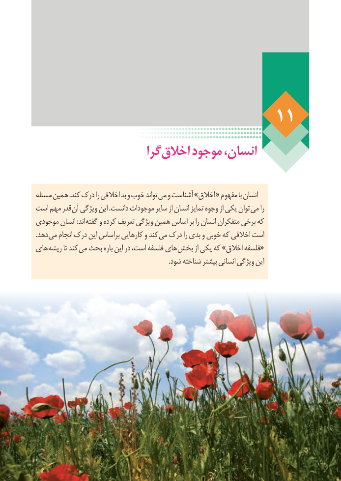

# PDF page 89

گرا اخالق موجود انسان،

 مسئله همین .کند درک را اخالقی بد و خوب تواند می و آشناست »اخالق « مفهوم با انسان
 است مهم قدر آن ویژگی این .دانست موجودات سایر از انسان تمایز وجوه از یکی توان می را
 موجودی انسان :اند گفته و کرده تعریف ویژگی همین اساس بر را انسان متفکران برخی که
  .دهد می انجام درک این براساس کارهایی و کند می درک را بدی و خوبی که اخالقی است
 های ریشه تا کند می بحث باره این در است، فلسفه های «بخش از یکی که »اخالق فلسفه
                                                                                 .شود شناخته بیشتر انسانی ویژگی این

83

