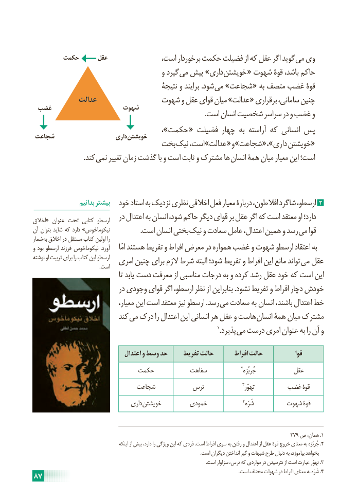

# PDF page 93

حکمت      عقل  ،گویداست برخوردار حکمت فضیلت از که عقل اگر       می وی
                                        و گیرد می پیش »داری خویشتن « شهوت قوۀ باشد، حاکم
                                         نتیجۀ و برایند .شود می »شجاعت « به متصف غضب قوۀ
             عدالت              شهوت و عقل قوای میان »عدالت « برقراری سامانی، چنین
 غضب                  شهوت
                                                                                                   .است انسان شخصیت سراسر در و غضب و
                                                                ،»حکمت  « فضیلت چهار به آراسته که انسانی پس شجاعت                     داری خویشتن
                            بخت نیک  ،عدالتاست »        « و »شجاعت  « ،»داری «خویشتن
       . کند نمی تغییر زمان گذشت با و است ثابت و مشترک ها انسان همۀ میان معیار این است؛

                  بدانیم بیشتر  خود استاد به نزدیک نظری اخالقی فعل معیار دربارۀ افالطون، شاگرد ارسطو، 2
اخالق« عنوان تحت کتابی ارسطو   در اعتدال به انسان شود، حاکم دیگر قوای بر عقل اگر که است معتقد او دارد؛
آن بتوان شاید که دارد »نیکوماخوس . است انسان بختی نیک و سعادت عامل اعتدال، همین و رسد می قوا
شمار به اخالق در مستقل کتاب اولین را
و بود ارسطو فرزند نیکوماخوس  .آورد     امّا هستند تفریط و افراط معرض در همواره غضب و شهوت ارسطو اعتقاد به
نوشته او تربیت برای را کتاب این ارسطو  امری چنین برای الزم شرط البته شود؛ تفریط و افراط این مانع تواند می عقل                                                    .است
                                         تا یابد دست معرفت از مناسبی درجات به و کرده رشد عقل خود که است این
                            در وجودی قوای اگر ارسطو، نظر از بنابراین .نشود تفریط و افراط دچار خودش
                                  معیار، این است معتقد نیز ارسطو .رسد می سعادت به انسان باشند، اعتدال خط
                          کند می درک را اعتدال این انسانی هر عقل و هاست انسان همۀ میان مشترک
                                                                                          1.پذیرد می درست امری عنوان به را آن و

                                 اعتدال و وسط حد     تفریط حالت       افراط حالت             قوا
                          حکمت           سفاهت                 2جُربُزه           عقل
                            شجاعت          ترس                   3تهوّر       غضب قوۀ
                                  داری خویشتن        خمودی                  4شَرَه        شهوت قوۀ

                                                                                             379 ص همان، .1
                                            اینکه از بیش دارد، را ویژگی این که فردی .است افراط سوی به رفتن و اعتدال از عقل قوۀ خروج معنای به جُربُزه .2
                                                                                                                                               .است دیگران انداختن گیر و شبهات طرح دنبال به بیاموزد، بخواهد
   .3است سزاوار ترس، که مواردی در نترسیدن از است عبارت تهوّر .
     ..است مختلف شهوات در افراط معنای به شَرَه 487

