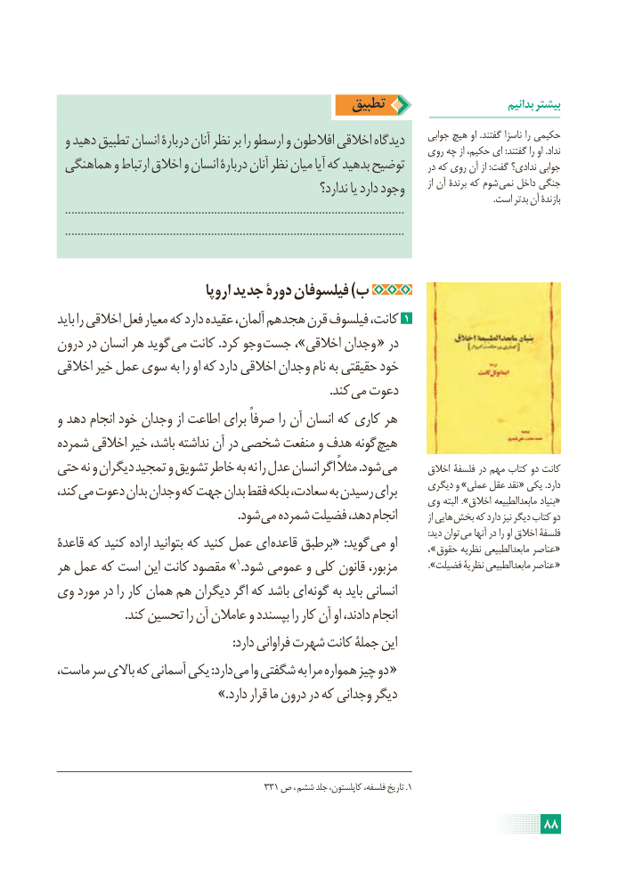

# PDF page 94

تطبیق                            بدانیم بیشتر
 و دهید تطبیق انسان دربارۀ آنان نظر بر را ارسطو و افالطون اخالقی دیدگاه     جوابی هیچ او .گفتند ناسزا را حکیمی                                                                     روی چه از حکیم، ای :گفتند را او .نداد
 هماهنگی و ارتباط اخالق و انسان دربارۀ آنان نظر میان آیا که بدهید توضیح      در که روی آن از :گفت ندادی؟ جوابی
                                                        ندارد؟ یا دارد وجود        از آن برندۀ که شوم نمی داخل جنگی                                                                                                                                                                                                  .است بدتر آن بازندۀ
  ...........................................................................................................
  ...........................................................................................................

                             اروپا جدید دورۀ فیلسوفان )ب
باید را اخالقی فعل معیار که دارد عقیده آلمان، هجدهم قرن فیلسوف کانت، 1
درون در انسان هر گوید می کانت .کرد وجو جست ،»اخالقی وجدان « در
اخالقی خیر عمل سوی به را او که دارد اخالقی وجدان نام به حقیقتی خود
                      . کند می دعوت
و دهد انجام خود وجدان از اطاعت برای صرفاً را آن انسان که کاری هر
شمرده اخالقی خیر باشد، نداشته آن در شخصی منفعت و هدف گونه هیچ
حتی نه و دیگران تمجید و تشویق خاطر به نه را عدل انسان اگر مثالً .شود می       اخالق فلسفۀ در مهم کتاب دو کانت
کند، می دعوت بدان وجدان که جهت بدان فقط بلکه سعادت، به رسیدن برای      دیگری و »عملی عقل نقد « یکی .دارد                                                           وی البته ».اخالق مابعدالطبیعه بنیاد«
              . شود می شمرده فضیلت دهد، انجام           از هایی بخش که دارد نیز دیگر کتاب دو
                                                                                                                                                                     :دید توان می آنها در را او اخالق فلسفۀ
قاعدۀ که کنید اراده بتوانید که کنید عمل ای قاعده برطبق« :گوید می او            ، » «حقوق نظریه مابعدالطبیعی عناصر
هر عمل که است این کانت مقصود » 1.شود عمومی و کلی قانون مزبور، ». «فضیلت نظریۀ مابعدالطبیعی عناصر
وی مورد در را کار همان هم دیگران اگر که باشد ای گونه به باید انسانی
                      .کند تحسین را آن عامالن و بپسندد را کار آن او دادند، انجام
                                                          :دارد فراوانی شهرت کانت جملۀ این
ماست، سر باالی که آسمانی یکی :دارد می وا شگفتی به مرا همواره چیز دو «
                               ».دارد قرار ما درون در که وجدانی دیگر

                                           331 ص ،  .ششم جلد کاپلستون، فلسفه، تاریخ 1

                                                                     88

