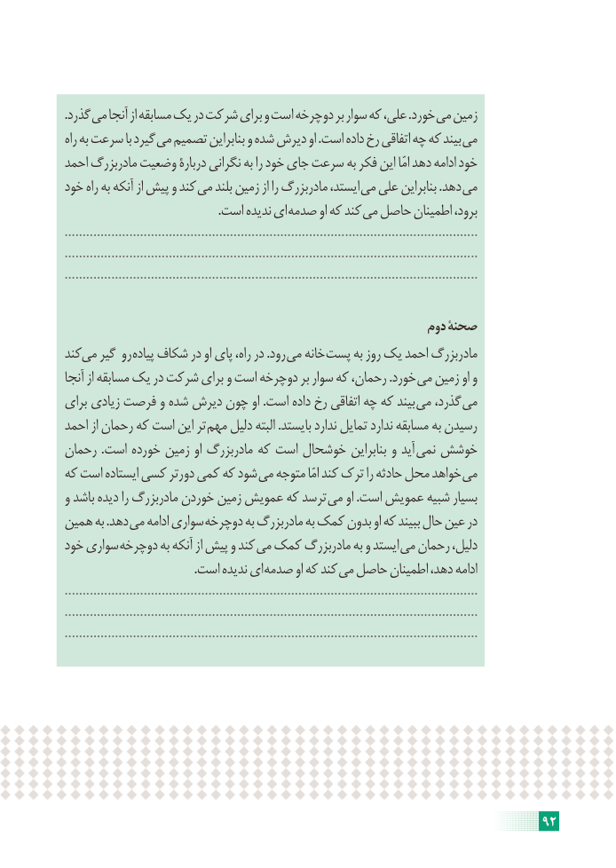

# PDF page 98

.گذرد می آنجا از مسابقه یک در شرکت برای و است دوچرخه بر سوار که علی، .خورد می زمین
راه به سرعت با گیرد می تصمیم بنابراین و شده دیرش او .است داده رخ اتفاقی چه که بیند می
احمد مادربزرگ وضعیت دربارۀ نگرانی به را خود جای سرعت به فکر این امّا دهد ادامه خود
خود راه به آنکه از پیش و کند می بلند زمین از را مادربزرگ ایستد، می علی بنابراین .دهد می
    . است ندیده ای صدمه او که کند می حاصل اطمینان برود،
...................................................................................................................
...................................................................................................................
...................................................................................................................

                                                         دوم صحنۀ
کندمی    گیر رو پیاده شکاف در او پای راه، در .رود می خانه پست به روز یک احمد مادربزرگ
آنجا از مسابقه یک در شرکت برای و است دوچرخه بر سوار که رحمان، .خورد می زمین او و
برای زیادی فرصت و شده دیرش چون او .است داده رخ اتفاقی چه که بیند می گذرد، می
احمد از رحمان که است این تر مهم دلیل البته .بایستد ندارد تمایل ندارد مسابقه به رسیدن
رحمان .است خورده زمین او مادربزرگ که است خوشحال بنابراین و آید نمی خوشش
که است ایستاده کسی دورتر کمی که شود می متوجه امّا کند ترک را حادثه محل خواهد می
و باشد دیده را مادربزرگ خوردن زمین عمویش که ترسد می او .است عمویش شبیه بسیار
همین به .دهد می ادامه سواری دوچرخه به مادربزرگ به کمک بدون او که ببیند حال عین در
خود سواری دوچرخه به آنکه از پیش و کند می کمک مادربزرگ به و ایستد می رحمان دلیل،
    . است ندیده ای صدمه او که کند می حاصل اطمینان دهد، ادامه
...................................................................................................................
...................................................................................................................
...................................................................................................................

                                                                    92

