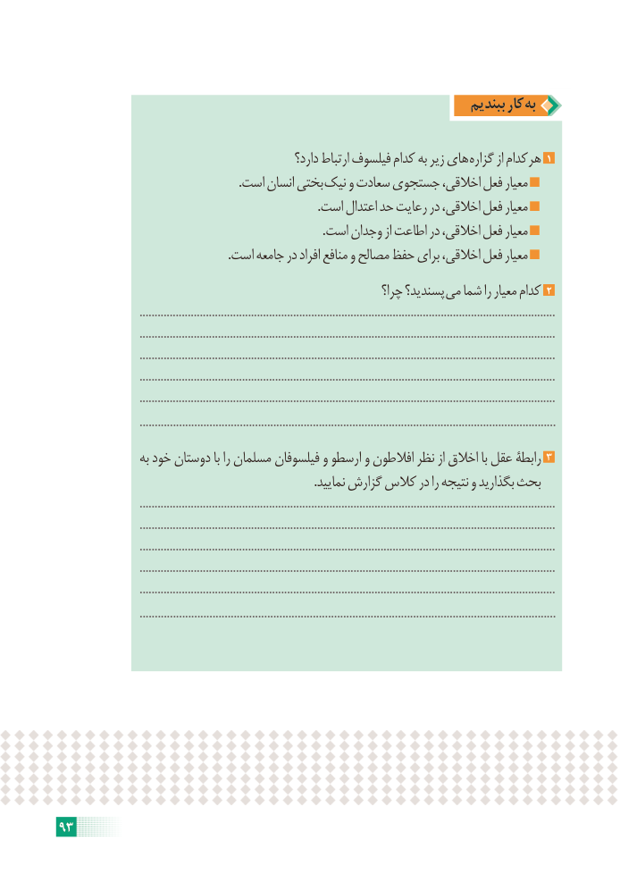

# PDF page 99

ببندیم کار به

                                                 دارد؟ ارتباط فیلسوف کدام به زیر های گزاره از هرکدام 1
                                                           .است انسان بختی نیک و سعادت جستجوی اخالقی، فعل معیار
                                                                                     .است اعتدال حد رعایت در اخالقی، فعل معیار
                                                                                       .است وجدان از اطاعت در اخالقی، فعل معیار
                                                       .است جامعه در افراد منافع و مصالح حفظ برای اخالقی، فعل معیار
                                                            چرا؟ پسندید؟ می شما را معیار کدام 2
                           ..........................................................................................................................................
                           ..........................................................................................................................................
                           ..........................................................................................................................................
                           ..........................................................................................................................................
                           ..........................................................................................................................................
                          .........................................................................................................................................
                به خود دوستان با را مسلمان فیلسوفان و ارسطو و افالطون نظر از اخالق با عقل رابطۀ 3
                                                                                    .نمایید گزارش کالس در را نتیجه و بگذارید بحث
                           ..........................................................................................................................................
                           ..........................................................................................................................................
                           ..........................................................................................................................................
                           ..........................................................................................................................................
                           ..........................................................................................................................................
                          .........................................................................................................................................

93

