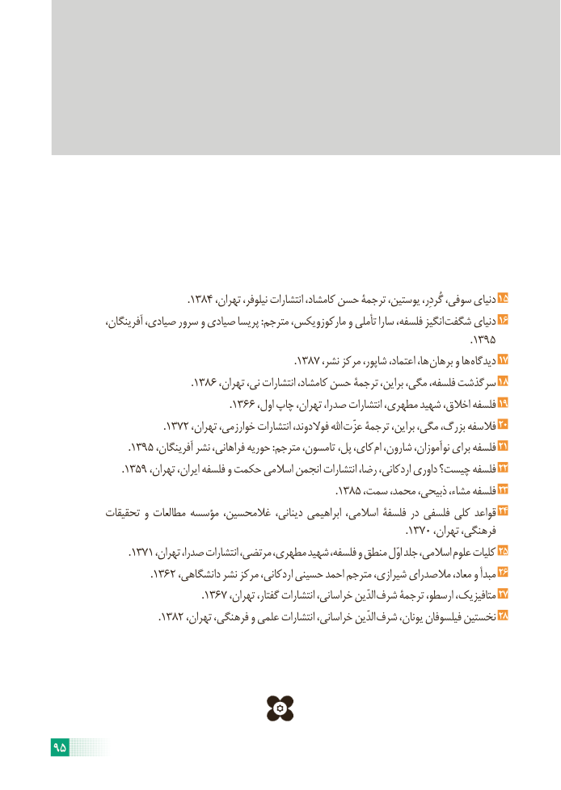

# PDF page 101

.١٣٨٤ ،دنیایتهران نیلوفر، انتشارات کامشاد، حسن ترجمۀ یوستین، گُردِر، سوفی،     15
 ،انگیزآفرینگان صیادی، سرور و صیادی پریسا :مترجم مارکوزویکس، و تأملی سارا فلسفه،       شگفت دنیای 16
                                                                                                                                                                          . ١٣٩٥
                                                                                                  .١٣٨٧ ،ها،نشر مرکز شاپور، اعتماد،     برهان و ها دیدگاه 17
                                                        .١٣٨٦ ،سرگذشتتهران نی، انتشارات کامشاد، حسن ترجمۀ براین، مگی، فلسفه،        18
                                  .1366 ،فلسفهاول چاپ تهران، صدرا، انتشارات مطهری، شهید اخالق،      19
                                             .١٣٧٢ ،اهللتهران خوارزمی، انتشارات فوالدوند،     عزّت ترجمۀ براین، مگی، بزرگ، فالسفه 20
                              . ١٣٩٥ ،تامسون،آفرینگان نشر فراهانی، حوریه :مترجم            ،کای،پل        ام شارون، نوآموزان، برای فلسفه 21
                            . ١٣٥٩ ،فلسفهتهران ایران، فلسفه و حکمت اسالمی انجمن انتشارات رضا، اردکانی، داوری چیست؟      22
                                                                                                                   .١٣٨٥ ،فلسفهسمت محمد، ذبیحی، مشاء،      23
          تحقیقات و مطالعات مؤسسه غالمحسین، دینانی، ابراهیمی اسالمی، فلسفۀ در فلسفی کلی قواعد 24
                                                                                                                                                .١٣٧٠ ،فرهنگی،تهران
                               .١٣٧١ ،کلیاتتهران صدرا، انتشارات مرتضی، مطهری، شهید فلسفه، و منطق اوّل جلد اسالمی، علوم      25
                                        .١٣٦٢ ،مبدأدانشگاهی نشر مرکز اردکانی، حسینی احمد مترجم شیرازی، مالصدرای معاد، و    26
                                                            .١٣٦٧ ،الدّینتهران گفتار، انتشارات خراسانی،        شرف ترجمۀ ارسطو، متافیزیک، 27
                                           .١٣٨٢ ،الدّینتهران فرهنگی، و علمی انتشارات خراسانی،        شرف یونان، فیلسوفان نخستین 28

95

