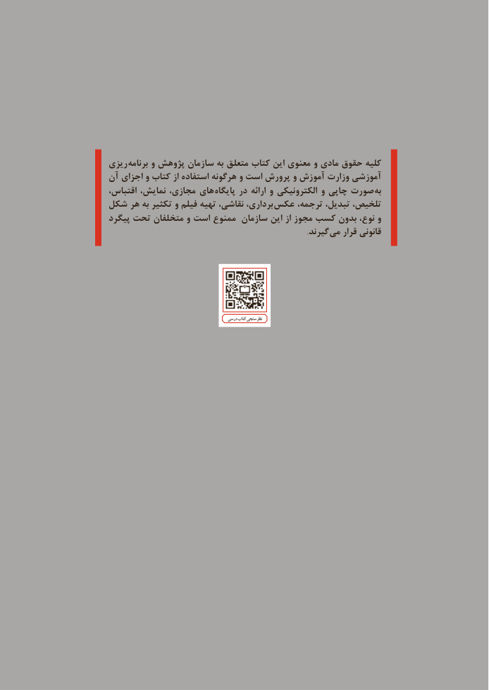

# PDF page 4

ریزی برنامه و پژوهش سازمان به متعلق کتاب این معنوی و مادی حقوق کلیه
آن اجزای و کتاب از استفاده هرگونه و است پرورش و آموزش وزارت آموزشی
اقتباس، نمایش، مجازی، های  پایگاه در ارائه و الکترونیکی و چاپی صورت  به
شکل هر به تکثیر و فیلم تهیه نقاشی، برداری،  عکس ترجمه، تبدیل، تلخیص،
پیگرد تحت متخلفان و است ممنوع سازمان این از مجوز کسب بدون نوع، و
                . گیرند می قرار قانونی

                                                 درسی کتاب نظرسنجی

