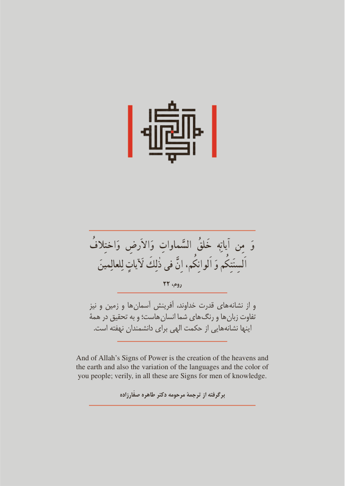

# PDF page 5

َُوَوَاختِالف  وَاالَرضِ  السَّماواتِ  خَلقُ   آياتِهٰ  مِن
         لِلعالِمين لَياتٍ ذٰلِكَ فی اِنَّ اَلوانِكُم، وَ اَلسِنَتِكُم
                        22 ،روم

     نیز و زمين و ها آسمان آفرينش خداوند، قدرت های نشانه از و
   همة در تحقیق به و هاست؛ انسان شما های رنگ و ها زبان تفاوت
.‌است نهفته دانشمندان برای الهی حکمت از هايینشانه اينها

And of Allah’s Signs of Power is the creation of the heavens and
the earth and also the variation of the languages and the color of
you people; verily, in all these are Signs for men of knowledge.

                    صفّارزاده طاهره دکتر مرحومه ترجمۀ از برگرفته

