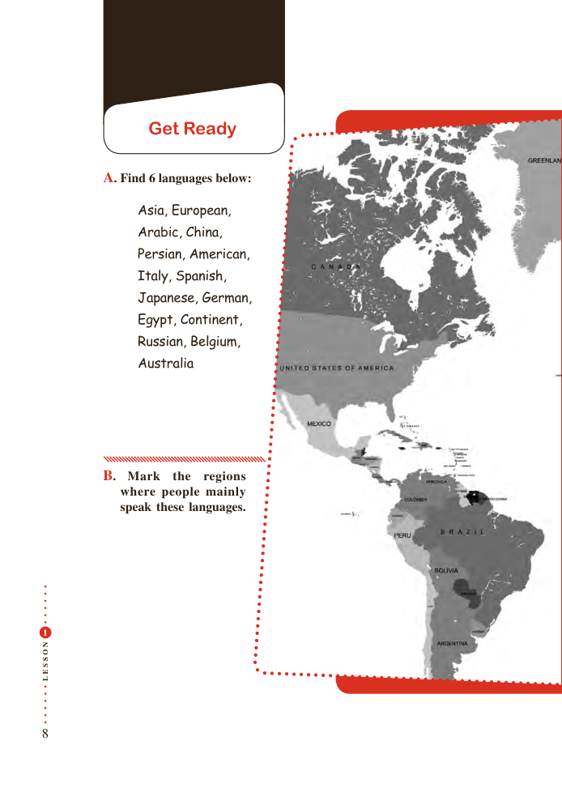

# PDF page 8

Get Ready

         A. Find 6 languages below:

                Asia, European,
               Arabic, China,
                Persian, American,
                 Italy, Spanish,
              Japanese, German,
               Egypt, Continent,
                Russian, Belgium,
                Australia

          B. Mark  the  regions
           where people mainly
             speak these languages.

 1

N
O

S

S
E
L

8

