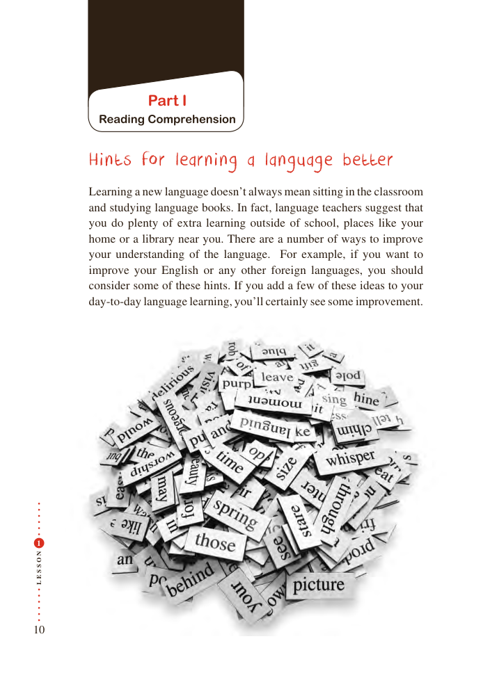

# PDF page 10

Part I
          Reading Comprehension

       Hints for learning a language better

          Learning a new language doesn’t always mean sitting in the classroom
          and studying language books. In fact, language teachers suggest that
         you do plenty of extra learning outside of school, places like your
        home or a library near you. There are a number of ways to improve
          your understanding of the language.  For example, if you want to
          improve your English or any other foreign languages, you should
           consider some of these hints. If you add a few of these ideas to your
           day-to-day language learning, you’ll certainly see some improvement.

 1

N
O

S

S
E
L

10

