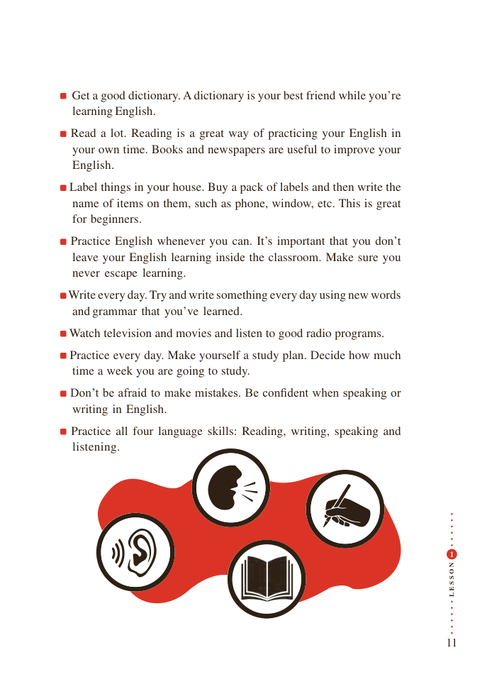

# PDF page 11

Get a good dictionary. A dictionary is your best friend while you’re
 learning English.
Read a lot. Reading is a great way of practicing your English in
 your own time. Books and newspapers are useful to improve your
 English.
Label things in your house. Buy a pack of labels and then write the
 name of items on them, such as phone, window, etc. This is great
 for beginners.
Practice English whenever you can. It’s important that you don’t
 leave your English learning inside the classroom. Make sure you
 never escape learning.
Write every day. Try and write something every day using new words
 and grammar that you’ve learned.
Watch television and movies and listen to good radio programs.
Practice every day. Make yourself a study plan. Decide how much
 time a week you are going to study.
Don’t be afraid to make mistakes. Be confident when speaking or
 writing in English.
 Practice all four language skills: Reading, writing, speaking and
 listening.

                                                                                                1

                                             N
                                             O

                                             S

                                             S
                                             E
                                             L

                                                                   11

