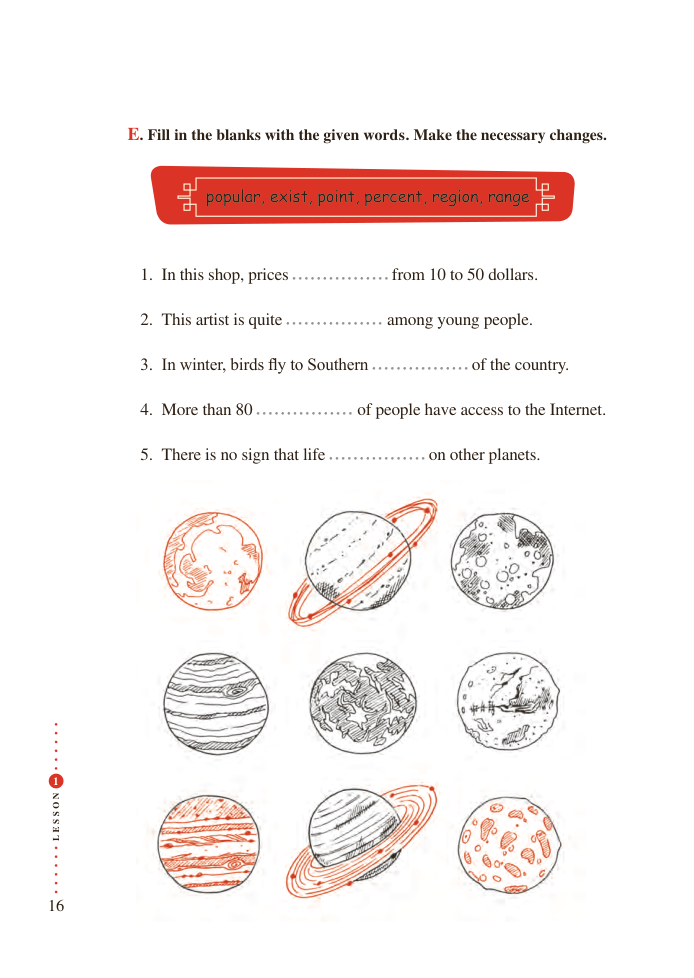

# PDF page 16

E. Fill in the blanks with the given word s . Make the necessary changes.

                     popular, exist, point, percent, region, range

               1. In this shop, prices             from 10 to 50 dollars.

               2. This artist is quite           among young people.

               3. In winter, birds fly to Southern               of the country.

               4. More than 80               of people have access to the Internet.

               5. There is no sign that life            on other planets.

 1

N
O

S

S
E
L

16

