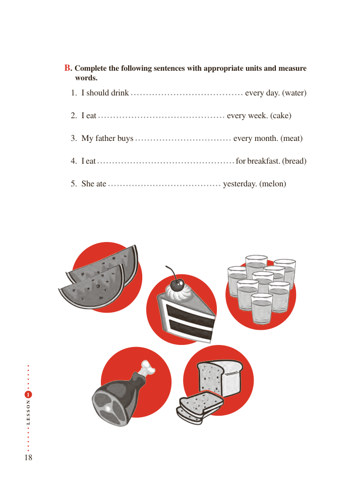

# PDF page 18

B. Complete the following sentences with appropriate units and measure
              words.
               1. I should drink                               every day. (water)

               2. I eat                                  every week. (cake)

               3. My father buys                          every month. (meat)

               4. I eat                                          for breakfast. (bread)

               5. She ate                                  yesterday. (melon)

 1

N
O

S

S
E
L

18

