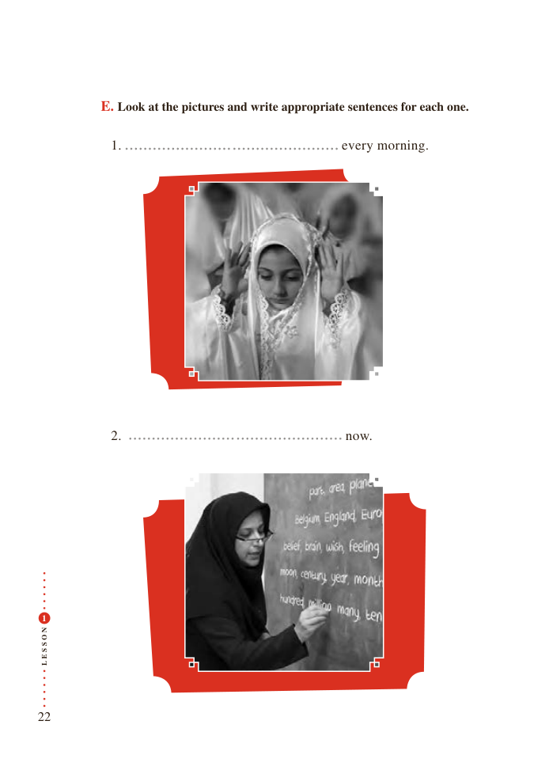

# PDF page 22

E. Look at the pictures and write appropriate sentences for each one.

              1.                                   every morning.

              2.                                 now.

 1

N
O

S

S
E
L

22

