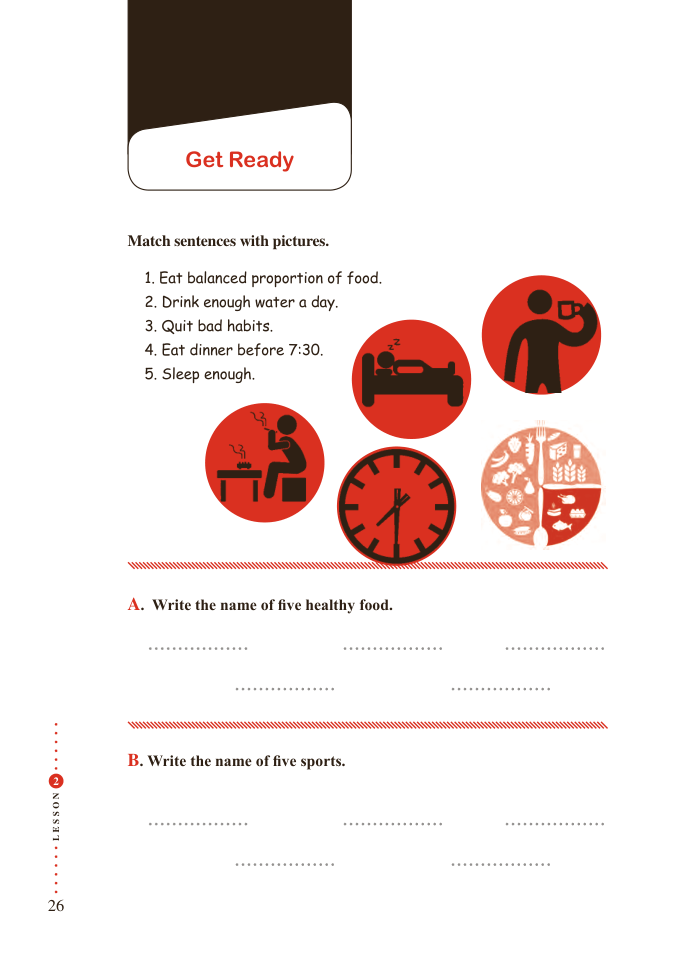

# PDF page 26

Get Ready

         Match sentences with pictures.

                   1. Eat balanced proportion of food.
               2. Drink enough water a day.
               3. Quit bad habits.
               4. Eat dinner before 7:30.
               5. Sleep enough.

         A. Write the name of five healthy food.

          B. Write the name of five sports.
 2

N
O

S

S
E
L

26

