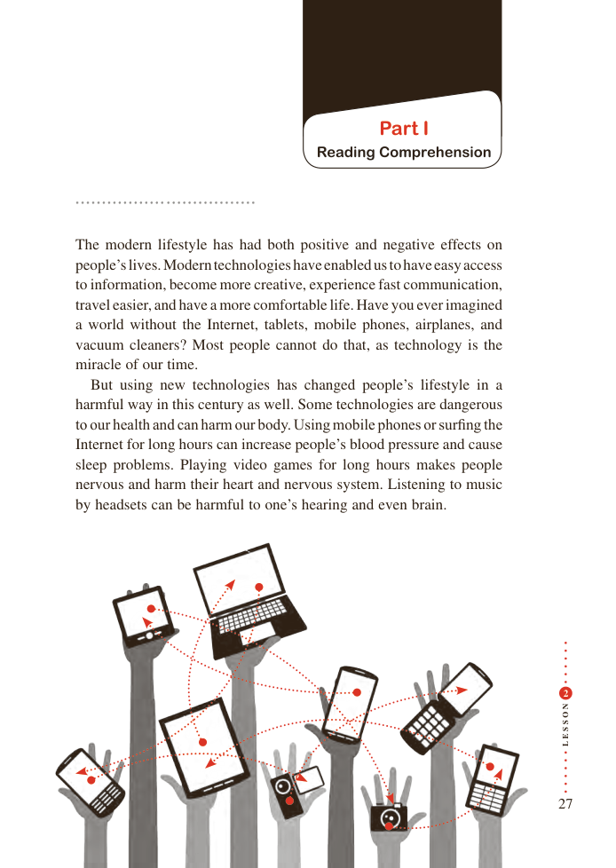

# PDF page 27

Part I
                             Reading Comprehension

The modern lifestyle has had both positive and negative effects on
people’s lives. Modern technologies have enabled us to have easy access
to information, become more creative, experience fast communication,
travel easier, and have a more comfortable life. Have you ever imagined
a world without the Internet, tablets, mobile phones, airplanes, and
vacuum cleaners? Most people cannot do that, as technology is the
miracle of our time.
  But using new technologies has changed people’s lifestyle in a
harmful way in this century as well. Some technologies are dangerous
to our health and can harm our body. Using mobile phones or surfing the
Internet for long hours can increase people’s blood pressure and cause
sleep problems. Playing video games for long hours makes people
nervous and harm their heart and nervous system. Listening to music
by headsets can be harmful to one’s hearing and even brain.

                                                                                                  2

                                             N
                                             O

                                             S

                                             S
                                             E
                                             L

                                                                  27

