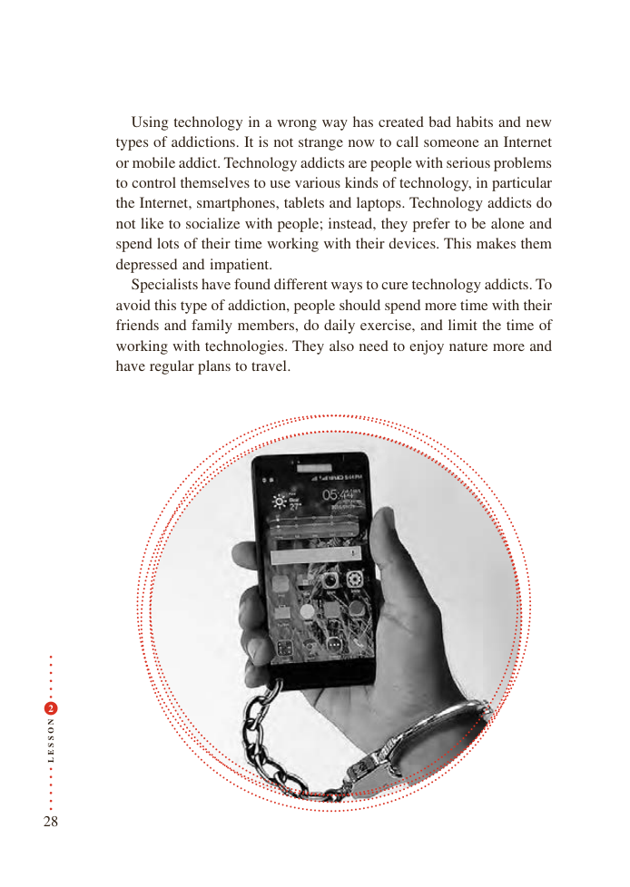

# PDF page 28

Using technology in a wrong way has created bad habits and new
           types of addictions. It is not strange now to call someone an Internet
           or mobile addict. Technology addicts are people with serious problems
            to control themselves to use various kinds of technology, in particular
           the Internet, smartphones, tablets and laptops. Technology addicts do
           not like to socialize with people; instead, they prefer to be alone and
          spend lots of their time working with their devices. This makes them
           depressed and impatient.
              Specialists have found different ways to cure technology addicts. To
          avoid this type of addiction, people should spend more time with their
            friends and family members, do daily exercise, and limit the time of
          working with technologies. They also need to enjoy nature more and
          have regular plans to travel.

 2

N
O

S

S
E
L

28

